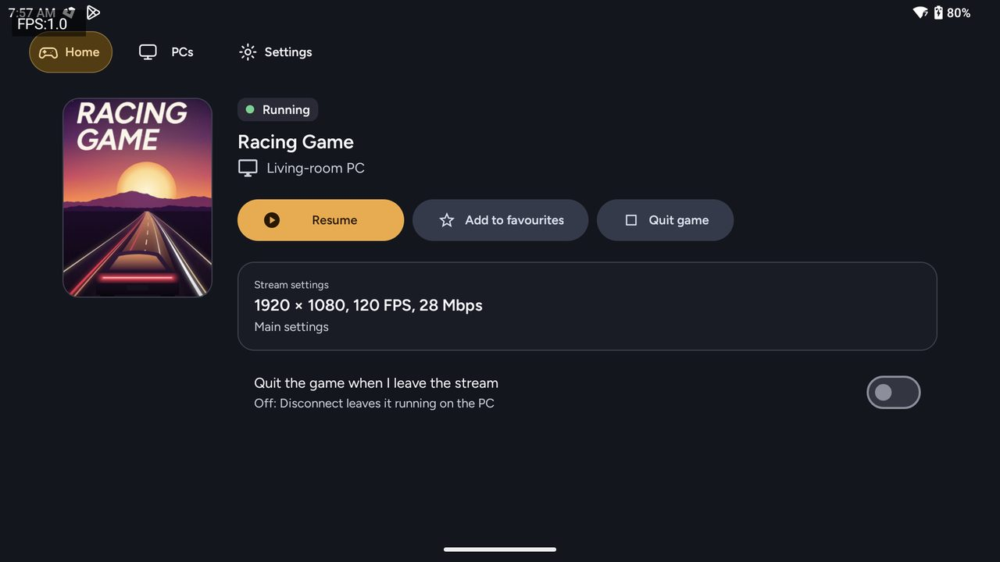
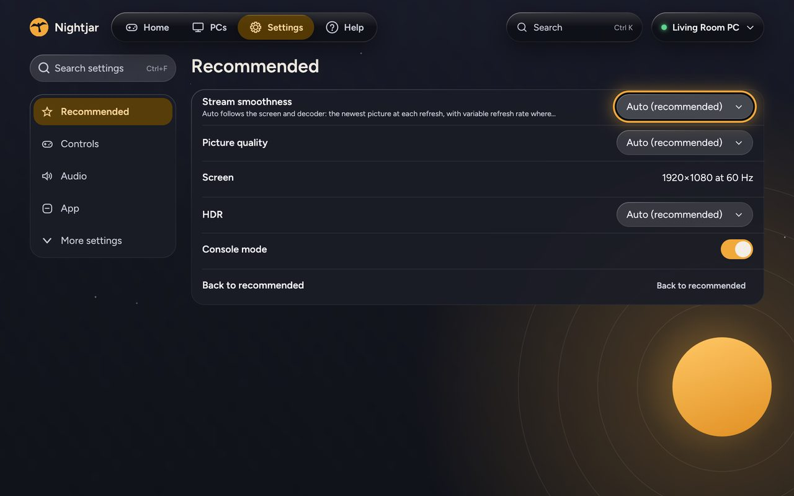
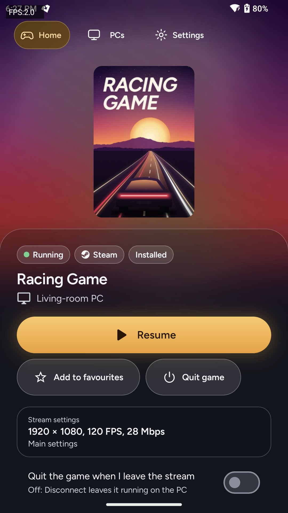
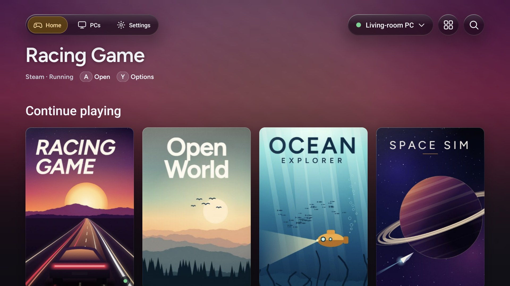
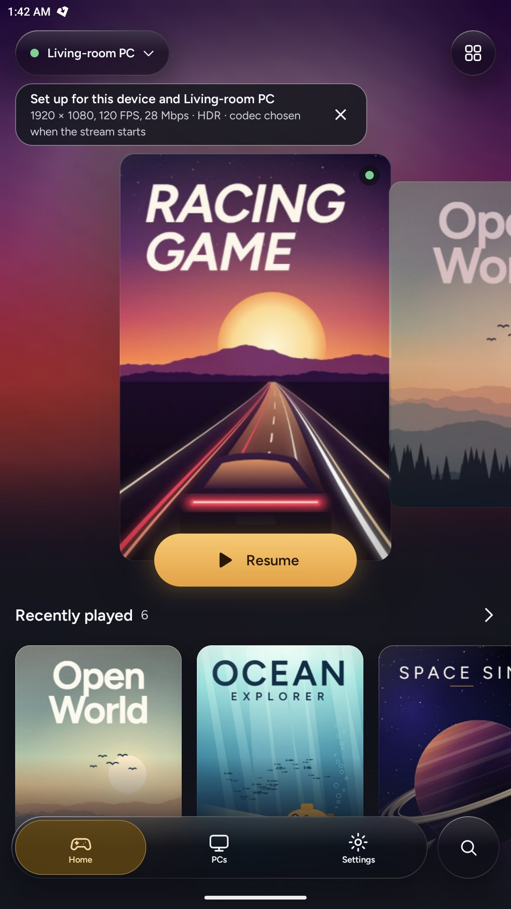

# Nightjar redesign, November 2026: simple first

[Documentation](index.md) · [Home and the session menu](console.md) · [Design: moonlit glass](../design/README.md) · [Code map](code-map.md)

This is the plan for making Nightjar simpler and more like a console, and the record of what Nightjar 6.0.0 builds of it. It builds on the look the app already has ([moonlit glass](../design/README.md): the night sky, glass chrome, one amber thing per screen) and changes how much the app asks of a player, not how it is drawn. The numbers it names are the keys of `design/tokens.json`.

## What players told us

From the survey threads (nightjar#61, nightjar#116, Rubylight#110) and the maintainer's own passes:

- Settings are too much, also for people who know streaming. The app listed eleven entries beside the settings, opened on Video and put its three plain choices (Recommended) among them.
- A controller or a remote has to reach everything, with focus that is always visible and a list that follows it.
- Home on a TV should show more than one row when the player wants that, with a choice of card size. (Home's **View** answers this on every form, a TV included: Grid, Rows or List, and three card sizes. See "TV Home as a grid" below.)
- The stream menu must be quick with a controller: the tile someone uses most should be one press away.
- Glass has to be steady: no late blur, no panel that turns transparent.

What already answers these on `main` and stays: Home with the hero and shelves on every form factor, a PC's own Home, the Recommended layer with Auto (recommended), Custom and Back to recommended, Console mode, the stream menu's tiles with their order and buttons, the Light theme.

## The experience, first launch to playing

One sentence per step is the test: if a step needs a second sentence to explain itself, it is too complicated.

| Step | What the player sees | What they do | What Nightjar does without asking |
| --- | --- | --- | --- |
| First launch | The sky, the moon with its orbit, "Searching for PCs…" and one action, Add PC | Nothing, or type an address | Finds PCs on the network; a found PC rises in as a card with Pair |
| Pair | The PIN, or the code to scan | Types the PIN on the PC, or scans | Reads the PC's library once it is paired, so Home has games when it opens |
| Home | The game to continue as the hero with Play, the games beside and below it | Presses Play (A, OK, Enter, a tap) | Wakes a sleeping PC, picks the PC that has the game, asks only when another game runs |
| A game's page | The cover on the game's own light, its state, one Play | Presses Play; Favourite and Quit game beside it | Shows the stream settings it will use; a profile is one press away |
| Connecting | The cover with the orbit around it and one word | Nothing; Back cancels | Chooses codec, resolution, refresh rate, HDR and bitrate from this device, this PC and this network |
| Playing | The game, nothing else | Holds Guide for the menu (Back on a remote, Ctrl+Alt+Shift+M on a keyboard) | Recovers an interrupted stream |
| Stream menu | Tiles for what is done mid-game, bitrate, Disconnect and Quit game | One press per tile | Remembers the tiles' order and buttons |
| Home, the first time | One card: what the automatic settings use for this device and this PC | Nothing; its close button puts it away for good | Works the values out from the screen, the decoders and the PC |
| Settings | Recommended: three choices, each on Auto | Changes one, or nothing | Maps the choices onto this device; everything else is under More settings |

## Information architecture

Three destinations, as today: **Home**, **PCs**, **Settings**. Nothing else is top level. A game's page, a PC's page, Profiles, Help and About hang off these and Back returns to what opened them with focus restored.

### Settings: four sections, then More settings

Before, the list beside the settings (the overview on a phone) was: Recommended, Presets, Profiles, Video, Display & image, Controls, Audio, Streaming, App, Advanced, Debug. Eleven entries, of which most players need four.

Now, on both apps:

| Always shown | Behind **More settings** (unfolds in place) |
| --- | --- |
| **Recommended**: stream smoothness, picture quality, screen, HDR, Console mode, Back to recommended | **Presets** (Android): one-tap sets of resolution, frame rate and bitrate |
| **Controls**: controllers, touch, mouse, keyboard, the stream menu's buttons | **Profiles**: different settings for different networks |
| **Audio**: channels, microphone | **Video**: resolution, frame rate, bitrate, codec, HDR details |
| **App**: theme, language, what opens at start, accessibility, Help, About | **Display & image**: pacing, variable refresh rate, upscaling, the PC's display |
| | **Streaming**: overlay, recovery, roaming, internet play |
| | **Advanced**: decoding, compatibility, artwork keys |
| | **Debug**: diagnostic switches |

Rules that keep it honest:

- Settings open on Recommended. (A TV still opens on Controls, its second row: that choice predates this plan and has its own focus history; see Decisions.)
- More settings is a row, not a page: it unfolds the entries under itself and folds them again. Both apps remember the player's own choice, across restarts too (Android beside each section's own "More … settings"; desktop in `settings.json`, as a field that is no setting). A screen reader hears whether it is open: on Android the row offers Expand while folded and Collapse while open, which TalkBack speaks as "collapsed" and "expanded"; the desktop names the state.
- Nothing is out of reach. Search looks in every section whether the fold is open or not. A link into a folded section (a failed start that points at Resolution, a search result, the presets) opens the fold for that visit. Folding while such a section is shown goes back to Recommended (on a TV to Controls, its start), with focus still on More settings, so the list never hides what the rows show.
- A PC's, a game's and a profile's settings list every section they have, without a fold: someone who opens them is already in the detail.
- No stored preference changes meaning, name or default. The fold is a view over the same sections, the same keys and the same per-section main rows and "More … settings" folds.

### What moves under Advanced, and what goes

The second level already exists inside every section: its main rows show, "More … settings (N)" holds the rest (`settings_tiers.xml` on Android, `main_row` on desktop). This plan adds the level above it and moves no row between sections. Three moves were proposed and the maintainer declined them: each changes where an experienced player looks. They are kept here as the record of what was weighed:

| Row | From | To | Why |
| --- | --- | --- | --- |
| Overlay (on, mode, position) | Streaming | App | It is how Nightjar looks, not how it streams; it is the row people look for first |
| Recover interrupted streams | Streaming (main) | Streaming (fold) | Always right; the row exists for diagnosis |
| Presets | Overview row | Video, as its first row | They set Video's three values; on desktop they already sit there |

Removal: the client rule is that a setting goes only when it never has an effect. An audit of every row against the code that reads it has not been made; 6.0.0 removes none.

## Visual language

The tokens stay. What the redesign adds is where each is used, so every screen reads as the same app.

**Type** (Figtree 400 and 600 only; the system face in languages Figtree lacks):

| Role | Token | Size / line | Where |
| --- | --- | --- | --- |
| Hero | `type.hero` | 56 / 60 on TV and desktop; 39 / 42 on a handheld | The game in focus on Home, a game's page |
| Large title | `type.largeTitle` | 36 / 42 | A page's name: PCs, a settings section |
| Title | `type.title` | 26 / 32 | A PC card's name, a dialog |
| Section | `type.section` | 20 / 26 | A shelf's heading, a group of settings |
| Body | `type.body` | 16 / 22 | Rows, buttons |
| Sub | `type.sub` | 14 / 19 | A row's value and hint |
| Caption | `type.caption` | 12 / 16 | Chips, key hints, the stats overlay |

One page uses at most three of these. Before, a game's page on a handheld used a 22 sp title under a 13 sp chip beside 16 sp buttons on a flat canvas; it now uses hero, body and caption, as Home does. On a phone held upright the sheet's title is `type.title`: the hero's 39 sp leaves a 360 dp screen two words a line.

**Spacing**: `space.xs` 4, `s` 8, `m` 12, `l` 16, `xl` 24, `xxl` 32, `xxxl` 48. Inside a group `m`; between groups `xl`; a page's gutter `xl` on a handheld, `xxxl` on TV and desktop. Touch targets at least `size.touchMin` (48 dp).

**Colour**, dark (night) and light (day):

| Token | Night | Day | Used for |
| --- | --- | --- | --- |
| `color.canvas` | `#14161F` | `day.color.canvas` | The page under everything |
| `color.label` | `#F5F6FB` | `day.color.label` (ink) | Text |
| `color.labelSecondary` | `#CDD0DC` | `day.color.labelSecondary` | Values, hints |
| `color.moon` / `moonHi` | `#F2A93B` / `#FFC765` | the same | Play, and nothing else that is solid |
| `tint.selected.fill` + `color.onSelected` | `#6B4700C2` + `#FFD79A` | `day.tint.selected.fill` + `day.color.onSelected` | The open tab, the open section, a tile that is on |
| `color.ok` | `#5FD38D` | the same | A PC that answers, a game that runs |
| `color.dangerFill` | `#93000A` | the same | Quit game, the one red control |

The stream menu and the statistics stay night in every theme: a stream is usually dark and a white panel over it would glare.

**Focus and hover**: one language. Focus is the moon ring (`focus.ringWidth` 3, 4 on TV) on a dark gap with a halo and a small lift (`focus.scaleCover` 1.08, `focus.scaleControl` 1.03); on the moon Play the ring is paper. Hover is the same step quieter: the fill lifts, no ring. The new More settings row takes exactly the section entries' hover, press and ring.

**Motion**: springs that settle under 250 ms (`motion.focus`, `motion.nav`, `motion.tabPill`), interruptible, only transform and alpha. The ambient cross-fades over `motion.ambient.ms` (180). Launching has no exit animation. The fold opens without animation: rows appear under the row that was pressed, and focus stays on it. Reduce motion turns springs into short fades.

## Navigation by input

| Input | Move | Go | Back | Options | The stream menu |
| --- | --- | --- | --- | --- | --- |
| Controller | D-pad, hat or left stick | A | B | X or Y | Hold Guide for a second, Start+Back+LB+RB, or the button chosen in Controls |
| TV remote | D-pad | OK | Back | Hold OK | Back |
| Touch | Tap, scroll | Tap | Back gesture | Long press | The gesture chosen in Controls |
| Mouse and keyboard | Pointer; arrows and Tab | Click, Enter | Esc | Right click | Ctrl+Alt+Shift+M |

Rules: nothing is reachable by touch or mouse only, and nothing by remote only. Hints show the keys of the device last used. Left from a settings row lands on the open section's entry; Down from App reaches More settings, A unfolds it, Down walks into what it unfolded.

## Before and after

Settings on a handheld (Retroid Pocket 6), before and after: eleven entries opening on Video; four sections opening on Recommended.

More settings chosen: the presets, Profiles and the sections of detail under it.

A game's page on a handheld, before and after: a flat page with Material buttons; Home's hero as a page, on the game's own ambient.

Settings on Windows, before and after.

Settings on a TV (TCL C6K), before and after.

## The game page on a phone held upright

The design gives a phone the game page as a sheet. Android draws it as a page: the game's ambient behind everything (the same picture Home was showing, so opening a game keeps the screen's light), the 2:3 cover on it, and under the cover a panel with the sheet's radius (`radius.sheet`) that holds the chips, the title, the PC, the moon Play across the width, Favourite and Quit game as glass capsules, and the stream settings. Play shows without scrolling, also with a long title and large text.

It does not drag: no grabber is drawn, and Back, or Home in the bar, leaves, as on every other form. A sheet that drags between detents over Home, with the cover morphing from its card, is not built.

## TV Home as a grid

Home's **View** (the grid button in the top row, reached with the remote) offers Grid, Rows and List and the card sizes Small, Medium and Large on a TV as on a phone; a TV keeps its shelves until the player chooses otherwise. This was in the apps before this redesign; the plan had listed it as missing. 6.0.0 adds nothing here; the picture is the TV layout with Grid and Large chosen.

## The set-up card

After the first pairing this device makes, Home shows one card: "Set up for this device and <PC>", and under it the values a stream to that PC starts with: resolution, frame rate, bitrate, HDR or SDR. It answers "is it set up right?" without opening Settings. There is nothing to press but its close button, which a remote, a pad and the keyboard reach; closed once, it never returns.

- It speaks for Recommended's Auto only. While the stream's settings are the player's own (Custom, or a choice other than Auto) the card does not show, and it comes back if they return to Auto before it was closed. Both apps ask the same thing: what Settings → Recommended shows, not one PC's own values. The line then gives what a stream to that PC starts with.
- The codec: Auto leaves it to the stream, which negotiates the best codec both ends decode when it starts (`simple_profile`), so before a stream ran there is none to name. The card says "codec chosen when the stream starts". A codec forced in Video makes the settings Custom, so the card does not show then; it names a codec only where that PC's own settings force one.
- It is offered once per install, by the pairing that leaves exactly one paired PC. A pairing on a device that already has a PC is not the first and offers nothing, then or later; nor does a PC that answers "already paired" (a link scanned again). A device that comes from a version before the card with a PC paired is marked at its first start, so pairing that PC again shows nothing.
- HDR reads as Recommended's row does on Android: left on Auto it is HDR where the screen and the decoder show it.
- While it shows, Up from the first row of games stops on its close button and Down from there returns, on a remote and a pad alike.
- It is part of the page, not a notice over it: Home's first content under the top row, with the games starting beneath it, and it scrolls away with them. On a TV it stands in the hero's band beside the game's name, which ends before it, so the shelves keep their height.
- It yields to "… wants to pair", which asks for an answer.

## What each app does

| | Android | Desktop |
| --- | --- | --- |
| Four sections, then More settings | Yes; a TV opens on Controls | Yes |
| More settings remembered across restarts | Yes (app state, not a preference) | Yes (`settings.json`, not a setting) |
| A screen reader hears the fold's state | Expand and Collapse actions on the row | The row's name says it |
| Presets | Behind More settings, as a row of the list | In Video, where they always were |
| A game's page on the game's ambient | Phone upright: the sheet under the cover. Sideways and handheld: Home's hero as a page. TV: its own layout with the same glass buttons | The page it already had: ambient, chips, hero title, Play |
| Home as a grid, with card sizes | View, on every form | View |
| The set-up card after the first pairing | Yes | Yes |

## Plan

**Done in Nightjar 6.0.0** (both apps unless said):

- The list of sections is simple first, with More settings; Settings open on Recommended. The fold is remembered across restarts and says its state to a screen reader.
- A game's page on Android sits on the game's ambient on every form: the sheet on a phone held upright, Home's hero as a page held sideways. The desktop already had this page; the TV keeps its layout and its Favourite and Quit buttons became the same glass capsules.
- A glass button that cannot be pressed dims (Play while a game cannot start); before, glass buttons were never disabled.
- The set-up card on Home after the first pairing.
- No protocol change, no preference renamed, moved or reinterpreted.

**Weighed and not built:**

- The row moves in the table above (Overlay to App, Presets into Video, Recover interrupted streams into its fold): declined.
- The stream menu's first row holding the four tiles the player used most.
- A dragging sheet for the phone's game page (detents, the cover morphing from its card).
- An audit of every setting against the code that reads it, with rows that never have an effect removed and their stored values cleared.
- The desktop first run and pairing drawn as one scene with the launch scene.

## Decisions taken

1. **A TV opens Settings on Controls, every other form on Recommended.** Kept.
2. **Presets behind More settings on Android.** Yes: they overlap with Recommended's Picture quality, and two "pick a quality" controls would share the first screen.
3. **The fold's memory.** The desktop remembers it across restarts, as Android does; only the player's own choice is kept, not a fold a link or a search result opened.
4. **The row moves.** Not made.
5. **TalkBack and the fold.** The row says its state and takes Expand and Collapse.
6. **The TV's default list in tests.** A Robolectric test with the TV's qualifiers and the fold closed walks it: Down from App lands on More settings, Select unfolds and Down reaches the presets; folding while Video is shown returns the pane to Controls with focus on More settings.
