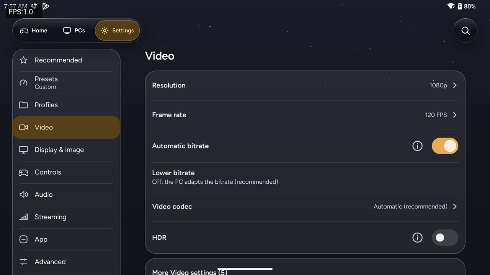
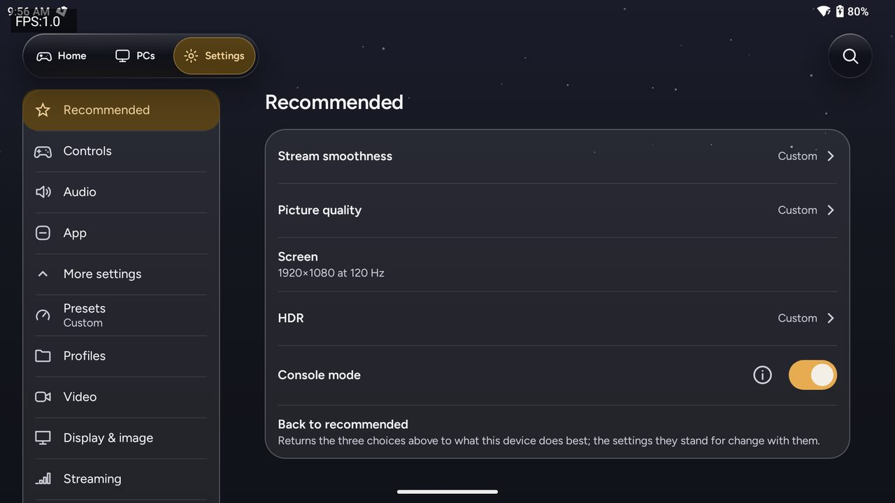
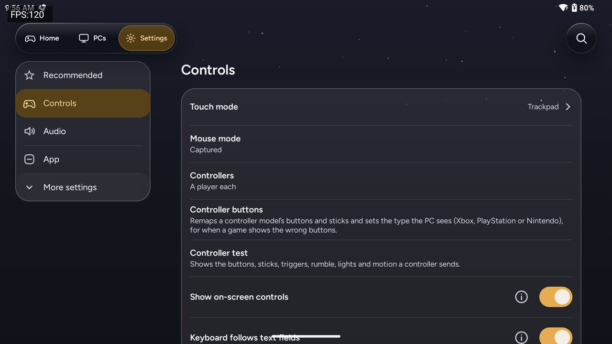
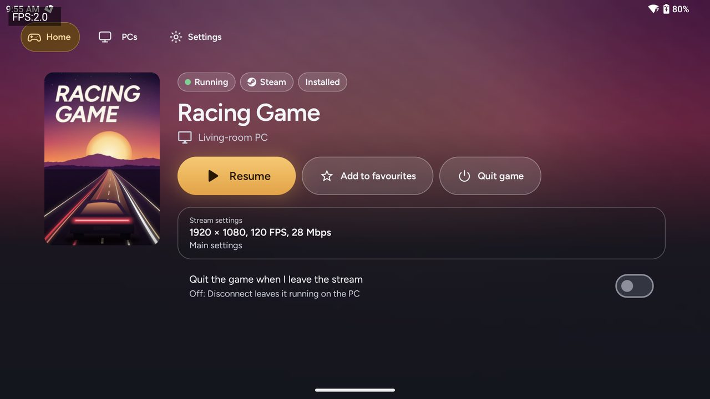
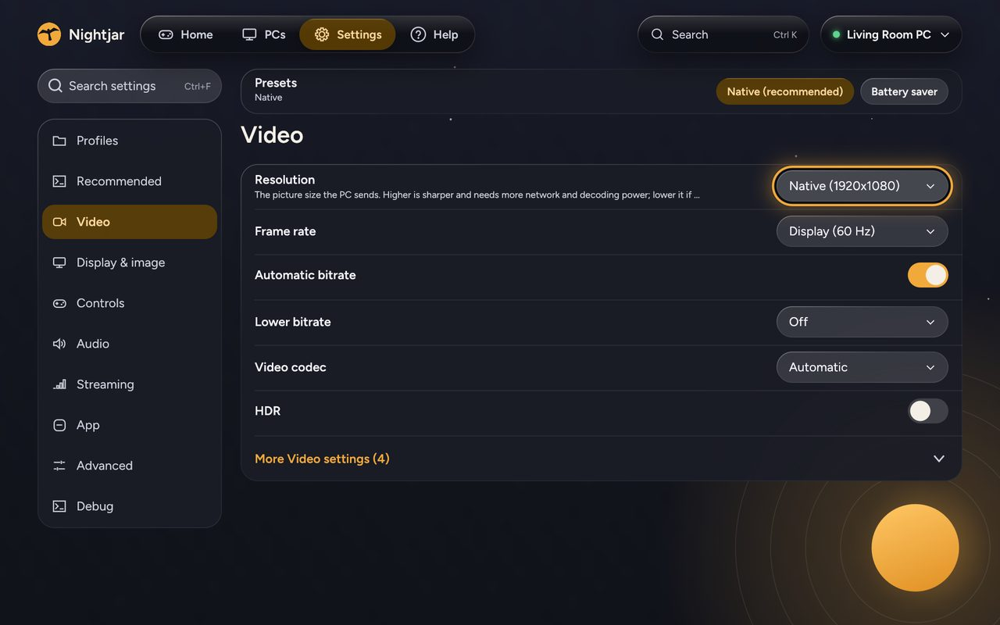
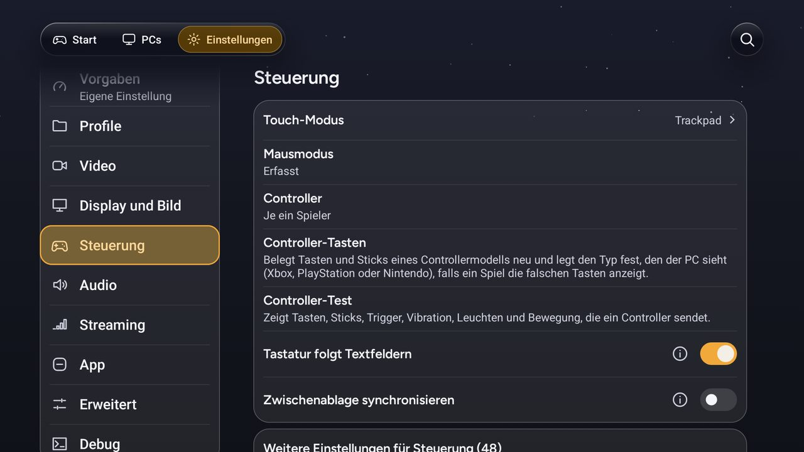
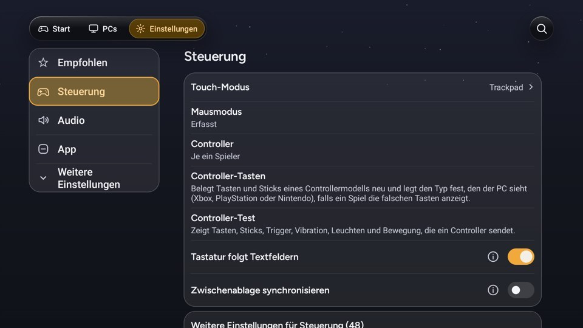

# Nightjar redesign, November 2026: simple first

[Documentation](index.md) · [Home and the session menu](console.md) · [Design: moonlit glass](../design/README.md) · [Code map](code-map.md)

This is the plan for making Nightjar simpler and more like a console, and the record of its first phase. It builds on the look the app already has ([moonlit glass](../design/README.md): the night sky, glass chrome, one amber thing per screen) and changes how much the app asks of a player, not how it is drawn. The numbers it names are the keys of `design/tokens.json`.

## What players told us

From the survey threads (nightjar#61, nightjar#116, Rubylight#110) and the maintainer's own passes:

- Settings are too much, also for people who know streaming. The app listed eleven entries beside the settings, opened on Video and put its three plain choices (Recommended) among them.
- A controller or a remote has to reach everything, with focus that is always visible and a list that follows it.
- Home on a TV should show more than one row when the player wants that, with a choice of card size.
- The stream menu must be quick with a controller: the tile someone uses most should be one press away.
- Glass has to be steady: no late blur, no panel that turns transparent.

What already answers these on `main` and stays: Home with the hero and shelves on every form factor, a PC's own Home, the Recommended layer with Auto (recommended), Custom and Back to recommended, Console mode, the stream menu's tiles with their order and buttons, the Light theme.

## The experience, first launch to playing

One sentence per step is the test: if a step needs a second sentence to explain itself, it is too complicated.

| Step | What the player sees | What they do | What Nightjar does without asking |
| --- | --- | --- | --- |
| First launch | The sky, the moon with its orbit, "Searching for PCs…" and one action, Add PC | Nothing, or type an address | Finds PCs on the network; a found PC rises in as a card with Pair |
| Pair | The PIN, or the code to scan | Types the PIN on the PC, or scans | Reads the PC's library once it is paired, so Home has games when it opens |
| Home | The game to continue as the hero with Play, the games beside and below it | Presses Play (A, OK, Enter, a tap) | Wakes a sleeping PC, picks the PC that has the game, asks only when another game runs |
| A game's page | The cover on the game's own light, its state, one Play | Presses Play; Favourite and Quit game beside it | Shows the stream settings it will use; a profile is one press away |
| Connecting | The cover with the orbit around it and one word | Nothing; Back cancels | Chooses codec, resolution, refresh rate, HDR and bitrate from this device, this PC and this network |
| Playing | The game, nothing else | Holds Guide for the menu (Back on a remote, Ctrl+Alt+Shift+M on a keyboard) | Recovers an interrupted stream |
| Stream menu | Tiles for what is done mid-game, bitrate, Disconnect and Quit game | One press per tile | Remembers the tiles' order and buttons |
| Settings | Recommended: three choices, each on Auto | Changes one, or nothing | Maps the choices onto this device; everything else is under More settings |

## Information architecture

Three destinations, as today: **Home**, **PCs**, **Settings**. Nothing else is top level. A game's page, a PC's page, Profiles, Help and About hang off these and Back returns to what opened them with focus restored.

### Settings: four sections, then More settings

Before, the list beside the settings (the overview on a phone) was: Recommended, Presets, Profiles, Video, Display & image, Controls, Audio, Streaming, App, Advanced, Debug. Eleven entries, of which most players need four.

Now, on both apps:

| Always shown | Behind **More settings** (unfolds in place) |
| --- | --- |
| **Recommended**: stream smoothness, picture quality, screen, HDR, Console mode, Back to recommended | **Presets** (Android): one-tap sets of resolution, frame rate and bitrate |
| **Controls**: controllers, touch, mouse, keyboard, the stream menu's buttons | **Profiles**: different settings for different networks |
| **Audio**: channels, microphone | **Video**: resolution, frame rate, bitrate, codec, HDR details |
| **App**: theme, language, what opens at start, accessibility, Help, About | **Display & image**: pacing, variable refresh rate, upscaling, the PC's display |
| | **Streaming**: overlay, recovery, roaming, internet play |
| | **Advanced**: decoding, compatibility, artwork keys |
| | **Debug**: diagnostic switches |

Rules that keep it honest:

- Settings open on Recommended. (A TV still opens on Controls, its second row: that choice predates this plan and has its own focus history; see Decisions.)
- More settings is a row, not a page: it unfolds the entries under itself and folds them again. Android remembers the choice between visits, as it does each section's own "More … settings"; desktop keeps it until Nightjar closes, as it keeps those.
- Nothing is out of reach. Search looks in every section whether the fold is open or not. A link into a folded section (a failed start that points at Resolution, a search result, the presets) opens the fold for that visit. Folding while such a section is shown goes back to Recommended, so the list never hides what the rows show.
- A PC's, a game's and a profile's settings list every section they have, without a fold: someone who opens them is already in the detail.
- No stored preference changes meaning, name or default. The fold is a view over the same sections, the same keys and the same per-section main rows and "More … settings" folds.

### What moves under Advanced, and what goes

The second level already exists inside every section: its main rows show, "More … settings (N)" holds the rest (`settings_tiers.xml` on Android, `main_row` on desktop). This plan adds the level above it and does not move a single row between sections in phase 1. Moves proposed for phase 2, each needing the maintainer's yes because it changes where an experienced player looks:

| Row | From | To | Why |
| --- | --- | --- | --- |
| Overlay (on, mode, position) | Streaming | App | It is how Nightjar looks, not how it streams; it is the row people look for first |
| Recover interrupted streams | Streaming (main) | Streaming (fold) | Always right; the row exists for diagnosis |
| Presets | Overview row | Video, as its first row | They set Video's three values; on desktop they already sit there |

Removal: the client rule is that a setting goes only when it never has an effect. An audit of every row against the code that reads it is phase 3 work (see the plan); phase 1 removes none.

## Visual language

The tokens stay. What the redesign adds is where each is used, so every screen reads as the same app.

**Type** (Figtree 400 and 600 only; the system face in languages Figtree lacks):

| Role | Token | Size / line | Where |
| --- | --- | --- | --- |
| Hero | `type.hero` | 56 / 60 on TV and desktop; 39 / 42 on a handheld | The game in focus on Home, a game's page |
| Large title | `type.largeTitle` | 36 / 42 | A page's name: PCs, a settings section |
| Title | `type.title` | 26 / 32 | A PC card's name, a dialog |
| Section | `type.section` | 20 / 26 | A shelf's heading, a group of settings |
| Body | `type.body` | 16 / 22 | Rows, buttons |
| Sub | `type.sub` | 14 / 19 | A row's value and hint |
| Caption | `type.caption` | 12 / 16 | Chips, key hints, the stats overlay |

One page uses at most three of these. Before phase 1, a game's page on a handheld used a 22 sp title under a 13 sp chip beside 16 sp buttons on a flat canvas; it now uses hero, body and caption, as Home does.

**Spacing**: `space.xs` 4, `s` 8, `m` 12, `l` 16, `xl` 24, `xxl` 32, `xxxl` 48. Inside a group `m`; between groups `xl`; a page's gutter `xl` on a handheld, `xxxl` on TV and desktop. Touch targets at least `size.touchMin` (48 dp).

**Colour**, dark (night) and light (day):

| Token | Night | Day | Used for |
| --- | --- | --- | --- |
| `color.canvas` | `#14161F` | `day.color.canvas` | The page under everything |
| `color.label` | `#F5F6FB` | `day.color.label` (ink) | Text |
| `color.labelSecondary` | `#CDD0DC` | `day.color.labelSecondary` | Values, hints |
| `color.moon` / `moonHi` | `#F2A93B` / `#FFC765` | the same | Play, and nothing else that is solid |
| `tint.selected.fill` + `color.onSelected` | `#6B4700C2` + `#FFD79A` | `day.tint.selected.fill` + `day.color.onSelected` | The open tab, the open section, a tile that is on |
| `color.ok` | `#5FD38D` | the same | A PC that answers, a game that runs |
| `color.dangerFill` | `#93000A` | the same | Quit game, the one red control |

The stream menu and the statistics stay night in every theme: a stream is usually dark and a white panel over it would glare.

**Focus and hover**: one language. Focus is the moon ring (`focus.ringWidth` 3, 4 on TV) on a dark gap with a halo and a small lift (`focus.scaleCover` 1.08, `focus.scaleControl` 1.03); on the moon Play the ring is paper. Hover is the same step quieter: the fill lifts, no ring. The new More settings row takes exactly the section entries' hover, press and ring.

**Motion**: springs that settle under 250 ms (`motion.focus`, `motion.nav`, `motion.tabPill`), interruptible, only transform and alpha. The ambient cross-fades over `motion.ambient.ms` (180). Launching has no exit animation. The fold opens without animation: rows appear under the row that was pressed, and focus stays on it. Reduce motion turns springs into short fades.

## Navigation by input

| Input | Move | Go | Back | Options | The stream menu |
| --- | --- | --- | --- | --- | --- |
| Controller | D-pad, hat or left stick | A | B | X or Y | Hold Guide for a second, Start+Back+LB+RB, or the button chosen in Controls |
| TV remote | D-pad | OK | Back | Hold OK | Back |
| Touch | Tap, scroll | Tap | Back gesture | Long press | The gesture chosen in Controls |
| Mouse and keyboard | Pointer; arrows and Tab | Click, Enter | Esc | Right click | Ctrl+Alt+Shift+M |

Rules: nothing is reachable by touch or mouse only, and nothing by remote only. Hints show the keys of the device last used. Left from a settings row lands on the open section's entry; Down from App reaches More settings, A unfolds it, Down walks into what it unfolded.

## Before and after

Settings on a handheld (Retroid Pocket 6), before and after: eleven entries opening on Video; four sections opening on Recommended.

More settings chosen: the presets, Profiles and the sections of detail under it.

A game's page on a handheld, before and after: a flat page with Material buttons; Home's hero as a page, on the game's own ambient.

Settings on Windows, before and after.

Settings on a TV (TCL C6K), before and after.

## Plan

**Phase 1, done in this change** (both apps unless said):

- The list of sections is simple first, with More settings; Settings open on Recommended.
- A game's page on a handheld and a phone held sideways is Home's hero as a page: ambient, chips, hero title, the moon Play with glass capsules, the stream settings on a panel. The desktop already had this page; the TV keeps its layout and its Favourite and Quit buttons become the same glass capsules.
- A glass button that cannot be pressed dims (Play while a game cannot start); before, glass buttons were never disabled.
- No protocol change, no preference renamed, moved or reinterpreted.

**Phase 2, navigation and flow** (needs the decisions below):

- A phone held upright gets the game page as the sheet the design describes, on the same ambient.
- The row moves in the table above (Overlay to App, Presets into Video).
- TV Home: a grid view with the card sizes Home already has on a phone, for players who want more than one row (nightjar#61).
- Recommended on the first run: after the first pairing, one card on Home says what Auto chose for this device and PC (resolution, refresh rate, HDR, codec), with nothing to press. It answers "is it set up right?" without opening Settings.
- The stream menu: the first row holds the four tiles the player used most, by count, unless they arranged the tiles themselves.

**Phase 3, depth**:

- An audit of every setting against the code that reads it; rows that never have an effect go, with their stored values cleared.
- One wording pass over Recommended's help after the row moves.
- The desktop first run and pairing drawn as one scene with the launch scene, so first launch to first frame is a single continuous picture.

## Decisions for the maintainer

1. **A TV opens Settings on Controls, every other form on Recommended.** Phase 1 keeps the TV's start (its tests and focus fixes assume it). One start everywhere would be simpler to explain.
2. **Presets behind More settings on Android.** They overlap with Recommended's Picture quality. Keeping both visible would put two "pick a quality" controls on the first screen.
3. **The fold's memory.** Android remembers More settings between visits; desktop until it closes, each following its own section folds. Persisting it on desktop needs a field in `settings.json` that is not a setting.
4. **The row moves of phase 2**, each of which changes where an experienced player looks.
5. **TalkBack hears "More settings" the same open or closed** on Android (the desktop says which). A row that says its state needs a custom row view; left for phase 2.
6. **Tests cover the default TV list only on the device.** The TV focus tests run with More settings open; folded, Down to More settings, Center and the walk through what it unfolds were checked on the TCL C6K, not in Robolectric.
