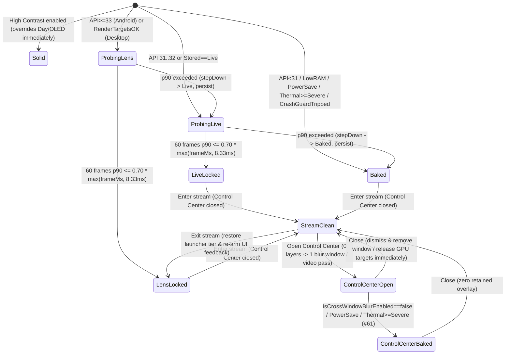

# Design 02: Nightjar 7.0 — Ground-Up Console-Quality Redesign (Wave 0)

Status: design specification (Phase 0). Written against `main` `b3d0c26b9b` (`6.2.0`) and [`00-protocol-reservations.md`](00-protocol-reservations.md).

## 1. Summary & User Experience

Nightjar 7.0 is a **ground-up, console-quality redesign ("Obsidian Cinema")** across every client surface and form factor — **Phone**, **Handheld (Retroid / Steam Deck / ROG Ally)**, **10-ft TV OS (Android TV / Fire TV)**, and **Native Desktop (Windows, Linux, macOS)** — explicitly **unshackled from the legacy "Moonlit Glass" (`client/design/README.md` / `client/docs/redesign-2026-11.md`) midnight-blue sky, moon-and-orbit-ring aesthetic**.

Crafted as the client sibling to Rubylight 7.0's Obsidian Studio language (PlayStation 5 × Apple tvOS × SteamOS OLED × studio-hardware precision), Nightjar 7.0 introduces a single-source 7.0 token architecture (`client/design/tokens.json` + completely rewritten `client/design/README.md`), a full-bleed Living Cover-Lit Hero Stage, a modular **Console Control Center** replacing legacy stream menus, visual preview-card Settings UX, animated First-Run & Pairing Cinema, a redesigned Android Virtual Controller Studio (`#151`), unified resolution-aware scaling (`#144`, `#146`), compositor/blur stability (`#61`), and a Wave 0 tactile soundscape/haptics contract — all with **zero wire-protocol changes**, **zero stream-time blur or extra compositor layers when closed**, and **zero new user-facing settings**.

### 1.1 Brand-New 7.0 Single-Source Design System (`client/design/tokens.json` & Rewritten `client/design/README.md`)

- **Obsidian Cinema Identity (Retiring Legacy "Moonlit Glass"):**
  - Replaces midnight-blue `#14161F` skies and floating moon-orbit motifs with true neutral **Obsidian** stages (`#090A0D` canvas, `#050608` TV cinema backdrop), layered smoked-mineral floating docks (`#101218D9` / `#181B24EB`) framed by razor-crisp 1 px top-lit specular rims, and warm **Cinema Amber** (`#F5B041`, `#1A1000` ink on Play, `#FFB94D` focus halo) reserved strictly for the single solid Play/Resume hero pill, active focus frame, and active selection state — zero competing accents.
  - **Full 4-Theme Parity across Android, TV, Handheld, and Desktop (Windows / Linux / macOS):**
    - **Night (Obsidian Cinema):** `#090A0D` stage, `#F5F7FA` primary / `#C7CDD9` secondary labels, cover ambient clamped to `<= 0.08` linear luminance (`7.53:1` primary / `5.06:1` secondary on worst-case pure white cover art).
    - **Day (Alabaster Studio):** Crisp mineral `#F5F7FA` canvas, frosted `#FFFFFFD9` docks with subtle `#0F172A1A` optical hairline, `#111318` / `#3A404D` ink, `#995800` focus ring, `#8A5000` accent ink, and cover ambient lifted to `>= 0.56` linear luminance (`10.79:1` primary / `6.04:1` secondary on worst-case pure black cover art).
    - **OLED (True Black):** `#000000` canvas and edge fades with calibrated specular rim contrast so tiles never float unanchored.
    - **High Contrast (AAA):** `Tier::Solid`, `#000000` canvas, `#FFFFFF` primary & secondary ink (`21.0:1`), `2 dp` `#B8BCCB` structural rim, `4 dp` `#FFC857` focus ring (`13.65:1`), zero halo/sheen/blur — overrides Day and OLED immediately without restart.
  - **Single-Source Generation Pipeline:** `client/design/tokens.json` remains the sole source of truth, compiled deterministically by `python client/scripts/gen_design_tokens.py --check` into:
    1. `client/app/src/main/res/values/design_tokens.xml`
    2. `client/protocol/desktop/src/ui/design_tokens.rs`
    3. `client/site/assets/design-tokens.css`
  - Mathematical and pixel contrast (`>= 4.5:1` text, `>= 3.0:1` focus/controls, `>= 7.0:1` High-Contrast, springs `<= 250 ms`) are enforced by updated `client/design/prototype/check-tokens.mjs` and `client/design/prototype/check-contrast.py` over worst-case white and black covers.

### 1.2 Cinematic Full-Bleed Console Home & Living Cover-Lit Hero Stage

- **Living Cover-Lit Hero Stage (`HeroStageView.java`, `ui/hero_stage.rs`):**
  - Focused game artwork fills the viewport edge-to-edge as a pre-baked, luminance-clamped ambient wash (±1 LSB dithered to eliminate banding, cross-fading smoothly once focus rests, zero per-frame blur on TV).
  - Clean PlayStation/tvOS-grade display typography (`Figtree-400` / `Figtree-600`, 49 KB bundled for 6 Latin-1 locales `en`, `de`, `es`, `fr`, `it`, `pt-BR`; whole-UI clean OS system sans fallback for the 9 non-Latin-1 locales `pl`, `tr`, `vi`, `ru`, `uk`, `ja`, `ko`, `zh-Hans`, `zh-Hant` so zero words ever mix fonts), tabular-num metadata pills (Host status, Running / Suspended state, 4K HDR / 120 fps profile), and a single solid Play/Resume hero capsule.
- **Dynamic Shelf, Grid & Collection Views:** Fluid horizontal hero shelves ("Continue Playing", "Recent", synced Collections), crisp toggleable All-Games grid, instant inline search, and **zero exit-animation delay on launch** (stream startup triggers immediately on press while the home stage fades underneath).
- **Unified 4-Tier Adaptive Surface Renderer (`lens`, `live`, `baked`, `solid`):** Shared `nightjar-policy::glass_probe` governs automatic capability landing and frame-time auto-stepdown across both Android (`GlassTier.java` / `GlassProbe.java`) and Desktop (`live_glass.rs` / `ui/glass_lens.rs`, adding Desktop `Tier::Lens` displaced-UV rim parity), using a 120 Hz budget floor (`8.33 ms`), 2 s warm-up settle, >25% late-frame filter, and 2-phase crash-guard sentinel. Budget TVs running `baked` receive an intentionally crafted obsidian finish, never a degraded box.

### 1.3 Console Control Center (Replacing Legacy Stream Menus) & Compositor/Blur Stability (#61)

Replaces the legacy text-list `StreamMenu` with a **floating Console Control Center dock + modular visual cards** (`nightjar-policy::control_center`, `ControlCenterDock.java`, `ControlCenterCards.java`, `ui/control_center.rs`, `ui/control_center_cards.rs`) organizing all live stream actions into **8 clean, capability-gated modules**:

1. **Quick Actions** — Resume, Disconnect, **Quit game** (the single red destructive control everywhere), Stats HUD toggle, Mouse / Keyboard / Orientation quick switches.
2. **Picture / VRR / Frame-Warp** — Live bitrate & quality slider, HDR-to-SDR tone-map selector (gated on `HostCapabilities::HdrSdrToneMap`), VRR pacing indicator, Frame Warp 2.0 status (gated on `HostCapabilities::FrameWarpV2`).
3. **Per-App Audio Mixer + Party Voice** — Game audio / host speaker mute, microphone push-to-talk/toggle, Couch Party Audio per-guest voice/game balance sliders (gated on `HostCapabilities::PartyAudio`).
4. **Instant Clip DVR** — One-tap **Save Replay Clip**, Manual Record toggle, and saved-clip confirmation chip (gated on `HostCapabilities::StreamDvr`).
5. **Graphics / Driver** — Host GPU / driver tuning and live stream settings rows (gated on advertised native stream/driver capabilities).
6. **Controller / Radial** — Opens the unified **Visual Console-Grade Controller Editor** (live controller diagram, Sticks & Triggers Studio, Gyroscope Studio, Trackpads & Radial Menu Builder, Haptics & Lightbar, layered `Global → Per-Controller-Model → Per-Game` profiles, and Input Deck radial switcher gated on `HostCapabilities::InputDeck`, expanded in [`13-client-input-deck.md`](13-client-input-deck.md)), plus direct **Touch Controller Studio** (`#151`) tab launch on Android.
7. **Guests** — Pending join requests, active guest permission pills, and mute/kick controls (gated on `session.guests`).
8. **Power / Suspend** — **Quick Suspend / Resume** (gated on `HostCapabilities::QuickSuspend`), End session, and host sleep controls.

**Hard Zero-Stream-Time-Blur & Issue #61 Stability Invariants:**
- **Closed = Zero Cost:** While a stream plays with the Control Center closed, **zero blur passes, zero extra Android windows, zero extra compositor surfaces, and zero added GPU work** occur. Persistent HUD widgets (stats capsule, transient hint, on-screen keyboards, Input Deck radial) draw strictly on `surface.hud.*` (`blur = 0`, `shadow = 0`) in the existing view pass.
- **Open = Compositor-Safe Blur (#61):**
  - Android API 31+ queries `WindowManager.isCrossWindowBlurEnabled` and opens ONE non-focusable `MenuBlurWindow` sized directly to the Control Center bounds (eliminating Android 14+ corner-animation glitches), while subscribing live to `addCrossWindowBlurEnabledListener`, `PowerManager` power-saver events, and thermal status callbacks (`>= SEVERE`) to fall back instantaneously to opaque-tinted `surface.controlCenter.baked.*` (`#0E1016EB`) with zero flash or compositor freeze. Closing the Control Center **removes** (`dismiss()` + unregisters listeners) the window immediately — never hides it — so post-close frame cost matches pre-open baseline. Coordinates cleanly with `CompositorHeartbeat` on TV firmware requiring UI composition stability.
  - Desktop captures the presenter's video frame into the blur chain ONLY while the Control Center is open and frees render targets (`stage.release()`) on the first frame after close.
  - **Night-Locked Over Video:** Control Center and all stream HUDs stay Obsidian Night in Night, Day, and OLED themes (High Contrast switches to `solid` black + rim), fixing the legacy `ui/glass.rs` Day-mode white glare bug.

### 1.4 Visual Preview-Card Settings UX

- Introduces clean vector/canvas **Visual Preview Cards** (`SettingsPreviewCard.java`, `ui/settings_previews.rs`) for high-impact streaming choices — **Frame Pacing** (frame-interval cadence bars illustrating Smooth vs Lowest Latency), **HDR & Tone-Mapping** (highlight roll-off comparison), **Upscaling / Sharpness**, and **Video Scaling / Aspect** (Fit vs Fill frame preview) — making settings immediately intuitive at a glance.
- **Unified Visual Controller Editor Entry Point (Settings → Controls):** Sets up the **Controls** section's clean flagship entry card for the unified **Visual Console-Grade Controller Editor** (Steam Input Configurator × Xbox Accessories × DualSense Edge Profile Studio caliber, fully implemented and migrated in Wave 3 [`13-client-input-deck.md`](13-client-input-deck.md)), replacing dozens of scattered flat controller preference rows (dead zones, stick inversion, button swaps, back paddles, gyro axes/sensitivity, trigger thresholds, rumble feel, per-model mappings, touch layouts) with lossless first-launch migration into the user's initial `Global` profile (`SettingsKeysTest` + `config.rs::migrate`).
- Preserves every hard Settings rule:
  - **4-section Recommended-first IA:** **Recommended**, **Controls** (anchored by the Visual Controller Editor), **Audio**, **App**, followed by the persistent **More settings** disclosure fold (**Presets**, **Profiles**, **Video**, **Display & image**, **Streaming**, **Advanced**, **Debug**).
  - **Fewer-settings rule:** Zero new user-facing settings added in Wave 0; existing keys stay 100% intact until Wave 3 Item 13 migrates flat controller keys cleanly into layered controller profiles (`SettingsKeysTest`).
  - **2-sentence help & 100% searchability:** Every preview card preserves crisp two-sentence plain-English help (benefit, trade-off, when to change) and registers its title, labels, and keywords in `SettingsSearch` and Desktop settings search.

### 1.5 First-Run & Pairing Cinema

- **Animated First-Run Discovery Stage (`ui/first_run.rs`, `PairingCinemaSheet.java`):** Replaces sparse empty lists with an obsidian discovery stage featuring a subtle ambient LAN scan pulse (static under `Motion.reduced()`), where discovered hosts rise in as tactile studio hardware cards showing live ping (`12 ms`) and a single amber **Pair** CTA (stepping down secondary Add-PC buttons so there is always only one amber primary action).
- **Instant QR Scan & PIN Pairing Cinema (`QrScanActivity.java`, `PairingCinemaSheet.java`):** Optical corner-bracket QR viewfinder on Android scanning Rubylight 7.0's installer or console QR payload in one shot, alongside a responsive 4-digit PIN pad (remote digit keys, D-pad, keyboard, and touch friendly) transitioning directly into the paired PC's Home stage.

### 1.6 Form-Factor-Native Ergonomics

| Form Factor | Navigation & Spatial Grammar | Control Center & Game Detail |
| --- | --- | --- |
| **10-ft TV OS** (Android TV / Fire TV) | Floating top command capsule; horizontal living-cover hero + shelves; 1.5× optical target scale (`>= 72 dp` effective); bright amber focus ring + `1.10×` lift + neighbor recess readable from 3 m even on `baked`; Back restores exact focused tile. | Right-docked 8-module Control Center (`blur-free` when closed); full-screen cover-lit Game Detail with zero nav bar clutter. |
| **Thumb-First Handheld OS** (Retroid / Steam Deck / ROG) | Compact floating top pill (Home / PCs / Settings + PC selector); split Hero + Continue rail optimized for left-thumb stick/D-pad ergonomics on 5–8" 720p–1080p displays. | Compact thumb-navigable Control Center dock + quick-tap shoulder-button module tabs (`LB`/`RB`). |
| **Physics-Sheet Phone UI** | Floating bottom navigation dock + round search pill; cover-morph shared-element transition from library card to Game Detail; spring-physics draggable sheets (`detentMedium` / `detentLarge`, flick-to-dismiss, scroll-to-drag handoff); notch/cutout safe insets. | Bottom physics-sheet Control Center + Modern Virtual Controller Studio (`#151`). |
| **Native Desktop** (Windows / Linux / macOS) | Top command capsule + full keyboard/mouse/gamepad navigation; sidebar Settings with anchored popovers; hi-DPI rendering across Windows D3D11/SDL GPU, Linux Wayland/X11/KMS, and macOS Metal. | Side-docked Control Center (`Esc` or Guide opens/closes cleanly, restoring cursor/input capture). |

### 1.7 Modern Virtual Controller Studio (`#151`, Android-Only — Seamless Touch Tab of the Visual Controller Editor)

- Complete console-grade visual redesign of Nightjar Android's on-screen virtual controller (`client/app/src/main/java/com/limelight/binding/input/pad/`), engineered in Wave 0 and seamlessly hosted as the **Touch** tab/mode inside Wave 3 Item 13's unified **Visual Controller Editor**:
  - **Console-Hardware Button Aesthetics (`PadSkin70.java`):** Crisp matte translucent hardware rings, responsive pressed-state illumination, calibrated thumbstick outer travel & deadzone guides, dynamic Xbox / PlayStation / Nintendo face-button glyphs driven by canonical `nightjar-policy::input_glyphs`, and smooth opacity down to **`0%`-opacity stealth mode** (invisible tactile zones for experienced players) with **zero stream-time blur**.
  - **Intuitive Full-Screen Visual Layout Editor (`PadSnapGrid.java`, `PadStudioInspector.java`):**
    - Freely resizable and reshapable controls across the **entire screen** with an 8 dp magnetic snap grid, live luminous center/edge/mirror alignment guides, and optional **Mirror Left/Right** symmetry lock.
    - **Separable ABXY & D-pad clusters** (Split/Join individual face buttons or directional keys cleanly for claw or custom layouts), direct drag-to-move, pinch-to-scale, and independent width/height corner handles.
    - **Movable floating micro-toolbar (`PadStudioInspector.java`):** Compact draggable studio dock (`surface.controlCenter.baked.*`, zero blur) that stays out of the way while tuning per-control size/shape, opacity (`0%` stealth through `100%`), Split/Join, Hide, Touchpad Mouse/Camera mode, Add-Control tray, quick presets (Standard, Compact, Shooter, Racing, Touchpad-First), Undo/Reset, and per-game vs global profile scope.

### 1.8 Resolution-Aware Scaling (`#144`, `#146`)

- Introduces a single deterministic scaling policy in **`client/protocol/policy/src/viewport_scale.rs`** (shared by Android via `ViewportScaler.java` / `AppTheme.java` / `AdaptiveLayout.java` and Desktop via `ui/viewport_scale.rs`):
  - Computes optical UI scale, safe-area inset margins, hero height ratio, cover grid column count, and type clamping strictly from `(logical_width_dp, logical_height_dp, physical_dpi, form_factor, user_scale_pct, is_tv_compact)`:
    - **720p handhelds (`#144`):** Eliminates cramped headers and oversized card padding on 1280×720 5.5–7" handhelds while preserving crisp 1-screen hero readability and `>= 48 dp` hit targets.
    - **1080p & 4K TVs (`#146`):** Normalizes overscan-safe 48 dp margins and optical 1.5× TV scale (`72 dp` effective target floor) regardless of vendor `densityDpi` quirks.
    - **Ultrawides (21:9 / 32:9) & Foldables:** Caps readable text/hero measure (`layout.stageMaxWidth`), expands cover grids smoothly up to 8 columns, and avoids `FoldingFeature` hinges cleanly.
  - Hard invariant: every interactive target stays **`>= 48 dp`** (`1.5×` on TV) across all supported resolutions and `2.0×` system font scales.

### 1.9 Tactile UI Soundscape + Micro-Haptics Contract, Canonical `input_glyphs.rs` & `strings_70` Overflow

- **Wave 0 Tactile Feedback Contract (`client/protocol/policy/src/ui_feedback_contract.rs`):** Defines semantic UI feedback events (`FocusTick`, `Confirm`, `Back`, `Toggle`, `SnapGrid`, `Reject`, `LaunchStart`) and the hard **stream-active mute gate** (`stream_active == true` suppresses all UI sound/rumble immediately) wired into Android `Haptics.java` and Desktop `ui/feedback_hook.rs` in Wave 0 — seamlessly expanded and acoustically calibrated with synthesized micro-sounds and gamepad menu rumble in Wave 4 Item 17.
- **Canonical `client/protocol/policy/src/input_glyphs.rs`:** Refactored from existing `client/protocol/desktop/src/glyphs.rs` (ported from **Moonlight V+** `streaming/input/gamepadglyphs.h` and `SdlGamepadKeyNavigation::detectUiStyle`, explicitly preserving Moonlight V+ port credits in code comments, `NOTICE`, `rust/THIRD_PARTY.md`, and `README.md` per `AGENTS.md`, never in UI text or release notes), owned by Item 02 and audited/extended in Wave 4 Item 17. Drives both Android and Desktop live on every input event:
  - **Xbox:** `A` / `Y` (default gamepad)
  - **PlayStation (VID `0x054C`):** `×` / `△`
  - **Nintendo (VID `0x057E`, respecting face-button swap):** `B` / `X`
  - **Keyboard:** `Enter` / `F` / `Esc`
  - **TV Remote (D-pad without gamepad buttons):** `OK` / `Hold OK`
  - **Touch / Mouse:** **No hints shown.**
- **Canonical 7.0.0 Desktop Translation Overflow (`client/protocol/desktop/src/strings_70/<code>.rs`):** Adds **ZERO** lines to the 14 grandfathered 1,750-LOC `client/protocol/desktop/src/strings/*.rs` files! All 7.0.0 Desktop translations across all 15 Nightjar locales (`en`, `de`, `es`, `fr`, `it`, `ja`, `ko`, `pl`, `pt_br`, `ru`, `tr`, `uk`, `vi`, `zh_hans`, `zh_hant`) live in chained `strings_70/mod.rs` + 14 `strings_70/<code>.rs` files (`<= 800` LOC each), resolved in `strings.rs` and verified by `strings/tests.rs`.

---

## 2. Protocol, Native API & Capability Contract

Per [`00-protocol-reservations.md`](00-protocol-reservations.md) §7, Wave 0 Item 02 requires **zero wire changes**:

| Surface | Contract |
| --- | --- |
| `PROTOCOL_VERSION` | **Unchanged.** |
| Control-stream IDs & Input magics | **None added.** |
| `/serverinfo`, RTSP `DESCRIBE` / `ANNOUNCE`, Native API v1 | **Unchanged (`API_VERSION = 1`).** |
| `HostCapabilities` gating | "Two ways in" navigation (Home stage for hosts with `HostCapabilities::Feature::NativeApi` vs PC list → App grid for Sunshine / Apollo / Vibepollo / GameStream hosts) AND every Console Control Center module (DVR, Quick Suspend, Party Audio, Input Deck, HDR-SDR Tone-Map, Frame Warp 2.0, Guests) gate strictly on `HostCapabilities::has(...)` / `HostCapabilities.has(...)`. **Zero** `Family::Rubylight` / `Family.RUBYLIGHT` feature checks (`tools/arch_check.py` enforced). |
| Single-source design tokens | `client/design/tokens.json` → `python client/scripts/gen_design_tokens.py` (sole `--check`-enforced generator; zero separate JS sync scripts) emits: (1) `client/app/src/main/res/values/design_tokens.xml`, (2) `client/protocol/desktop/src/ui/design_tokens.rs`, (3) `client/site/assets/design-tokens.css`. CI runs `gen_design_tokens.py --check`, `test_gen_design_tokens.py`, and `node client/design/prototype/check-tokens.mjs`. |
| 7.0 token schema coverage | Rewritten `tokens.json` includes Obsidian Cinema Night, Alabaster Studio Day (`day.*`), True Black OLED (`oled.*`), AAA High-Contrast (`hc.*`), Control Center surface/HUD tokens (`surface.controlCenter.*`, `surface.hud.*`), Virtual Controller Studio tokens (`pad.studio.*`), resolution scaling clamps (`layout.stageMaxWidth`, `layout.touchMin`, `layout.tvScaleFactor`), probe tokens (`tier.probe.settleMs = 2000`, `tier.probe.lateFraction = 0.25`, `tier.probe.minBudgetHz = 120`), and spring definitions (all settle `<= 250 ms`). |

---

## 3. Architecture & <=800-LOC Module Plan

All new modules comply with `tools/arch_check.py`: `<= 800` LOC ceiling, `//!` Rust headers, `/**` Java headers, zero `Family::Rubylight` gating, and explicit OS-intent comments on any `cfg(...unix...)` in `client/protocol/desktop/` (using `target_os = "linux"` for Linux-only code so macOS builds cleanly).

### 3.1 Grandfathered Files in `tools/size_ratchet.json` (STRICT CEILING PROTECTION)

| Existing File | `size_ratchet.json` Ceiling | Strategy to Avoid Growth |
| --- | ---: | --- |
| `client/protocol/desktop/src/ui/glass.rs` `[verify post-sprint code-map.md]` | **1289** LOC | Extract Desktop `Tier::Lens` displaced-UV rim + `Material::Menu` night-lock guard into `ui/glass_lens.rs` (~180 LOC). Net LOC `<= 1289`. |
| `client/protocol/desktop/src/ui/home.rs` & `ui/game.rs` `[verify post-sprint code-map.md]` | **1057** / **1202** LOC | Extract shared Obsidian Cinema cover-lit hero stage & metadata pills into `ui/hero_stage.rs` (~280 LOC); both files shrink below ceilings. |
| `client/protocol/desktop/src/ui/chrome.rs` `[verify post-sprint code-map.md]` | **1021** LOC | Extract dynamic input hint bar into `ui/input_source.rs` (~170 LOC). Net LOC `<= 1021`. |
| `client/protocol/desktop/src/ui/settings.rs` `[verify post-sprint code-map.md]` | **4087** LOC | Place visual preview cards in `ui/settings_previews.rs` (~240 LOC) and fold persistence in `ui/settings_fold.rs` (~130 LOC). Net LOC `<= 4087`. |
| `client/protocol/desktop/src/theme.rs` `[verify post-sprint code-map.md]` | **1305** LOC | Extract Figtree Latin-1 vs 9-locale system font loading into `ui/font_locale.rs` (~150 LOC). Shrinks below 1250 LOC. |
| `client/protocol/desktop/src/gui.rs` `[verify post-sprint code-map.md]` | **938** LOC | Keep Control Center video-frame blur target capture inside `live_glass.rs` (`<= 740` LOC) + `ui/glass_lens.rs`. Net LOC `<= 938`. |
| `client/protocol/desktop/src/config.rs` `[verify post-sprint code-map.md]` | **2639** LOC | Keep probe verdict state in `live_glass.rs`; only internal `settings_more_open` remains (+0 net LOC). |
| `client/app/src/main/java/com/limelight/preferences/StreamSettings.java` `[verify post-sprint code-map.md]` | **3425** LOC | Extract visual preview cards into `SettingsPreviewCard.java` (~240 LOC) and fold persistence/TalkBack delegate into `SettingsFoldState.java` (~150 LOC); `StreamSettings.java` shrinks. |
| `client/app/src/main/java/com/limelight/ui/StreamMenu.java` `[verify post-sprint code-map.md]` | **1321** LOC | Delegate the 8-module Console Control Center to `ControlCenterDock.java` (~300 LOC) + `ControlCenterCards.java` (~320 LOC); `StreamMenu.java` shrinks cleanly. |
| `client/app/src/main/java/com/limelight/console/ConsoleHomeActivity.java` & `GameDetailActivity.java` `[verify post-sprint code-map.md]` | **1440** / **1167** LOC | Delegate Living Cover-Lit Hero Stage to `HeroStageView.java` (~280 LOC) and Pairing Cinema to `PairingCinemaSheet.java` (~260 LOC); both shrink. |
| `client/app/src/main/java/com/limelight/binding/input/pad/PadEditor.java` & `PadPainter.java` `[verify post-sprint code-map.md]` | **1157** / **1113** LOC | Extract 7.0 console-hardware rendering into `PadSkin70.java` (~280 LOC), magnetic snap-grid/mirror solver into `PadSnapGrid.java` (~220 LOC), and floating studio inspector into `PadStudioInspector.java` (~260 LOC); both grandfathered files **shrink** well below ceilings! |
| `client/protocol/desktop/src/strings/*.rs` (14 files: `de.rs`..`zh_hant.rs`) `[verify post-sprint code-map.md]` | **1750** LOC each (**0 headroom**) | **ZERO lines are added to `strings/*.rs`.** All 7.0.0 Desktop translations land exclusively in canonical `client/protocol/desktop/src/strings_70/mod.rs` + 14 per-locale `strings_70/<code>.rs` files (`<= 800` LOC each), chained in `strings.rs` and verified by `strings/tests.rs`. |

### 3.2 Full Module Plan (Every New File `<= 800` LOC)

| Path | Status | Est. LOC | Ownership |
| --- | --- | ---: | --- |
| `client/design/tokens.json` & `client/design/README.md` `[verify post-sprint code-map.md]` | Rewrite | ~800 / ~240 | Brand-new 7.0 Obsidian Cinema single-source tokens (Night, Day, OLED, High-Contrast, Control Center, Pad Studio, Scaling) and rewritten design specification. |
| `client/scripts/gen_design_tokens.py` & `test_gen_design_tokens.py` `[verify post-sprint code-map.md]` | Modify | ~195 / ~140 | Sole `--check`-enforced token generator emitting Android XML (`design_tokens.xml`), Desktop Rust (`ui/design_tokens.rs`), and Nightjar site CSS (`client/site/assets/design-tokens.css`). |
| `client/protocol/policy/src/glass_probe.rs` `[verify post-sprint code-map.md]` | New | ~180 | `//!` Shared 4-tier landing (`Lens`, `Live`, `Baked`, `Solid`), 120 Hz budget floor, 2 s settle, >25% late-frame filter, and stepdown hysteresis. |
| `client/protocol/policy/src/viewport_scale.rs` `[verify post-sprint code-map.md]` | New | ~220 | `//!` Unified resolution/DPI/viewport scaling policy (`#144`, `#146`) for 720p handhelds, 1080p/4K TVs, ultrawides, and foldables guaranteeing `>= 48 dp` (`1.5×` TV) targets. |
| `client/protocol/policy/src/input_glyphs.rs` `[verify post-sprint code-map.md]` | New | ~210 | `//!` Canonical shared input-glyph module owned by Item 02 and audited/extended in Wave 4 Item 17: refactored from `desktop/src/glyphs.rs` (preserving Moonlight V+ port credits in code comments, `NOTICE`, `rust/THIRD_PARTY.md`, and `README.md`) covering Xbox, PlayStation (`0x054C`), Nintendo (`0x057E`), Keyboard, TV Remote (`OK`/`Hold OK`), Touch/Mouse (none), and Latin-1 Figtree locale predicate. |
| `client/protocol/policy/src/ui_feedback_contract.rs` `[verify post-sprint code-map.md]` | New | ~130 | `//!` Wave 0 tactile soundscape + micro-haptics event contract (`FocusTick`, `Confirm`, `Back`, `Toggle`, `SnapGrid`, `Reject`, `LaunchStart`) and hard stream-active mute gate (expanded in Wave 4 Item 17). |
| `client/protocol/policy/src/control_center.rs` `[verify post-sprint code-map.md]` | New | ~240 | `//!` Shared 8-module Console Control Center state & `HostCapabilities` visibility matrix (Quick Actions, Picture/VRR/Frame-Warp, Audio/Party, DVR, Graphics/Driver, Controller/Radial, Guests, Power/Suspend). |
| `client/protocol/android/src/policy_ui_70.rs` & `lib.rs` `[verify post-sprint code-map.md]` | New / Modify | ~220 / ~140 | `//!` JNI bridge exposing `glass_probe`, `viewport_scale`, `input_glyphs`, `control_center`, and `ui_feedback_contract` to Android Java. |
| `client/protocol/desktop/src/live_glass.rs`, `ui/glass_lens.rs`, `ui/glass.rs`, `ui/backdrop.rs`, `theme.rs`, `gui.rs` `[verify post-sprint code-map.md]` | Modify / New | ~740 / ~180 / ~1260 / ~360 / ~1230 / ~930 | Desktop 7.0 Obsidian Cinema 4-tier renderer (`Tier::Lens`), Night/Day/OLED/High-Contrast parity, `Material::Menu` night-lock, zero blur when Control Center closed. |
| `client/protocol/desktop/src/ui/viewport_scale.rs`, `ui/hero_stage.rs`, `ui/home.rs`, `ui/game.rs`, `ui/first_run.rs` `[verify post-sprint code-map.md]` | New / Modify | ~170 / ~280 / ~920 / ~1040 / ~440 | Desktop resolution-aware scaling (`#144`/`#146`), full-bleed Living Cover-Lit Hero Stage, dynamic shelf/grid, and animated First-Run & Pairing Cinema. |
| `client/protocol/desktop/src/ui/control_center.rs`, `ui/control_center_cards.rs`, `stream_menu.rs`, `menu_style.rs` `[verify post-sprint code-map.md]` | New / Modify | ~290 / ~310 / ~520 / ~220 | Desktop 8-module Console Control Center dock & visual cards with zero blur when closed. |
| `client/protocol/desktop/src/ui/settings_previews.rs`, `ui/settings_fold.rs`, `ui/settings.rs`, `ui/settings_tests.rs` `[verify post-sprint code-map.md]` | New / Modify | ~240 / ~130 / ~3980 / ~540 | Desktop visual preview-card Settings UX, persistent 4-section + *More settings* fold, 100% searchability. |
| `client/protocol/desktop/src/glyphs.rs`, `ui/input_source.rs`, `ui/font_locale.rs`, `ui/feedback_hook.rs`, `ui/chrome.rs` `[verify post-sprint code-map.md]` | Modify / New | ~540 / ~170 / ~150 / ~120 / ~980 | Refactors `glyphs.rs` onto canonical `nightjar_policy::input_glyphs` (keeping Moonlight V+ credit), live SDL3 input source tracking, Figtree vs 9-locale OS sans loader, and Wave 0 feedback contract hook. |
| `client/app/src/main/java/com/limelight/ui/ViewportScaler.java`, `AppTheme.java`, `AdaptiveLayout.java`, `GlassForm.java` `[verify post-sprint code-map.md]` | New / Modify | ~210 / ~330 / ~290 / ~45 | Android JNI consumer of `viewport_scale.rs` (`#144`/`#146`), 4-theme Obsidian Cinema parity, ultrawide/foldable/TV 1.5× scaling. |
| `client/app/src/main/java/com/limelight/ui/HeroStageView.java`, `PairingCinemaSheet.java`, `LocaleTypeface.java`, `GlassTier.java`, `GlassProbe.java`, `InputSource.java`, `Haptics.java` `[verify post-sprint code-map.md]` | New / Modify | ~280 / ~260 / ~120 / ~125 / ~175 / ~140 / ~110 | Living Cover-Lit Hero Stage, animated QR/PIN Pairing Cinema, Figtree Latin-1 vs system sans, 4-tier probe + crash-guard sentinel, canonical `input_glyphs` binding, Wave 0 haptic event hook. |
| `client/app/src/main/java/com/limelight/ui/ControlCenterDock.java`, `ControlCenterCards.java`, `MenuBlurWindow.java`, `StreamMenu.java`, `StreamMenuModel.java`, `CompositorHeartbeat.java` `[verify post-sprint code-map.md]` | New / Modify | ~300 / ~320 / ~195 / ~1140 / ~310 / ~115 | Android 8-module Console Control Center + `#61` hardened `MenuBlurWindow` (live `isCrossWindowBlurEnabled` / power-save / thermal listeners, instant removal on close, zero blur when closed). |
| `client/app/src/main/java/com/limelight/preferences/SettingsPreviewCard.java`, `SettingsFoldState.java`, `StreamSettings.java`, `QrScanActivity.java` `[verify post-sprint code-map.md]` | New / Modify | ~240 / ~150 / ~3280 / ~260 | Android visual preview-card Settings UX, persistent fold + TalkBack delegate, optical QR Pairing Cinema viewfinder. |
| `client/app/src/main/java/com/limelight/binding/input/pad/PadSkin70.java`, `PadSnapGrid.java`, `PadStudioInspector.java`, `PadPainter.java`, `PadEditor.java`, `ModernController.java`, `PadGlyphs.java` `[verify post-sprint code-map.md]` | New / Modify | ~280 / ~220 / ~260 / ~860 / ~890 / ~410 / ~160 | Modern Virtual Controller Studio (`#151`, Android-only): console-grade hardware visuals, 8 dp magnetic snap-grid + alignment guides + mirror mode, dynamic glyphs, shrinking `PadEditor`/`PadPainter`. |
| `client/protocol/desktop/src/strings.rs`, `strings/tests.rs`, `strings_70/mod.rs`, `strings_70/<code>.rs` (14 files) `[verify post-sprint code-map.md]` | Modify / New | ~330 / ~780 / ~80 / `<=220` each | Canonical 7.0.0 Desktop translation overflow tables across all 14 non-English locales (**ZERO** edits to grandfathered `strings/*.rs`!). |
| `client/app/src/main/res/values*/strings.xml` (15 locales) `[verify post-sprint code-map.md]` | Modify | ~existing | Complete 15-locale translations for all 7.0 UI labels, Control Center module titles, visual preview cards, Pairing Cinema, and Virtual Controller Studio. |

---

## 4. State Machine, Reconnect Matrix & Crash-Restore Journal

### 4.1 Adaptive Surface Tier & Stream-Time Control Center Lifecycle (`#61`)

### 4.2 Reconnect, Compositor Stability (#61) & Form-Factor Matrix

| Scenario | Android (Phone / Handheld / TV) | Desktop (Win / Linux / macOS) |
| --- | --- | --- |
| **Stream active, Control Center closed** | **0** blur windows, **0** extra compositor surfaces; Stats / Input Deck radial / Virtual Controller draw strictly on blur-0 `surface.hud.*`; UI feedback contract muted. | `Glass::set_over_video(true)` frees SDL blur targets immediately (`held == false`); `pass_tier()` emits zero `Boundary` markers; UI feedback muted. |
| **Control Center opens then closes (#61)** | API 31+ with `isCrossWindowBlurEnabled`: creates 1 `MenuBlurWindow` sized to dock bounds (no corner-grow glitch), attaches live blur/power/thermal callbacks; close calls `dismiss()` + unregisters listeners so WindowManager count returns to pre-open baseline. | Samples presenter video texture ONLY while open; close calls `stage.release()` on next frame so post-close frame time equals pre-open baseline. |
| **Battery saver, thermal severe, or tunneling turns blur off mid-stream (#61)** | Live `addCrossWindowBlurEnabledListener` / `PowerManager` / thermal callback switches open Control Center instantly to opaque-tinted `surface.controlCenter.baked.*` with zero transparency leak or frame hitch (transient, never persisted as hardware failure). | Display refresh switch (`set_refresh`) re-evaluates budget against 120 Hz floor; `renderer_changed()` discards targets and re-probes cleanly. |
| **720p handheld / 4K TV / ultrawide / foldable resize (#144, #146)** | `ViewportScaler` + `AdaptiveLayout` recompute optical scale, grid columns, safe-area insets, and `FoldingFeature` hinge split dynamically; every hit target stays `>= 48 dp` (`>= 72 dp` on TV). | `ui/viewport_scale.rs` clamps hero text measure on 21:9/32:9 monitors, scales columns up to 8, and holds cached nine-slice during window drag (`WINDOW_REST_S = 0.25 s`). |
| **Virtual Controller Studio drag / rotate / cancel (#151)** | `PadSnapGrid` snaps to 8 dp grid + mirrors symmetric controls; rotating keeps draft inside safe insets; Cancel/Back discards draft cleanly with zero mutation to persisted profile. | N/A (Android-only touch controller studio). |
| **Input hot-swap (TV Remote → DualSense → Nintendo → Keyboard → Touch)** | `InputSource` calls canonical `nightjar-policy::input_glyphs` on every event; hints switch instantaneously (`OK/Hold OK` → `×/△` → `B/X` → `Enter/F` → hidden) with zero animation. | `ui/input_source.rs` reads `SDL_Event` + gamepad VID/type via canonical `nightjar_policy::input_glyphs`; updates instantaneously with zero animation. |
| **Stream reconnect / network roam** | Control Center closes and removes any blur window before `ConnectingScreen` appears; first decoded frame drops connecting sheet with zero residual overlay layers. | Same; Control Center closes and releases blur targets immediately on disconnect. |

### 4.3 Crash-Restore Journal (Client GPU Probe Safety)

Nightjar mutates zero host OS state. To protect against buggy mobile or desktop GPU drivers crashing during initial `RenderEffect` / render-target allocation, both Android (`GlassTier.java`) and Desktop (`live_glass.rs`) enforce a **2-phase crash-guard sentinel**:
1. Before the first `Lens` / `Live` target allocation for `(version_code, os_or_gpu_fingerprint)`, atomically commit `probe_in_flight = true`.
2. Immediately after the first `Lens` / `Live` frame presents cleanly, clear `probe_in_flight = false`.
3. If the app relaunches and detects `probe_in_flight == true` for the current build/driver fingerprint, it logs a visible warning ("Previous live-surface probe did not finish; using baked surfaces") and persists `Baked` for that fingerprint so Nightjar never crash-loops.

---

## 5. Settings & 10/10 Craft Plan

- **Fewer-settings rule:** **Zero** new user-facing settings added in Wave 0! Surface tier selection (`glass_probe`), resolution-aware scaling (`viewport_scale` `#144`/`#146`), and `#61` live blur fallback are 100% automatic. Persistent *More settings* fold stays UI state (`settings_more_open` in Desktop `settings.json`, non-preference `SharedPreferences` on Android), keeping `SettingsKeysTest` clean with zero broken or reused keys. (Wave 4 Item 17 adds the single opt-in `ui_sounds` toggle on top of Wave 0's feedback contract.)
- **Default-off / zero-overhead gates:** Stream-time blur while the Control Center is closed is unconditionally **off** (hard architectural invariant, never a setting). Desktop `Tier::Lens` is self-gated by the 60-frame p90 probe with automatic stepdown to `Live` → `Baked`.
- **Plain-English error states:** Failed connections render as an obsidian sheet over the originating screen with the unshortened real error message, single amber **Try again**, **Test the network**, and **Back**; disabled controls render as flat muted wells rather than washed-out opacity fades.
- **Visual Preview-Card Settings:** Every preview card preserves the 4-section IA (`Recommended`, `Controls`, `Audio`, `App` + *More settings* fold), exact 2-sentence plain-English help, and 100% keyword searchability.
- **Dynamic input glyphs:** Canonical `client/protocol/policy/src/input_glyphs.rs` (preserving Moonlight V+ port credits in code comments, `NOTICE`, `rust/THIRD_PARTY.md`, and `README.md`) enforces exact live switching across Xbox, PlayStation, Nintendo, Keyboard, TV Remote (`OK`/`Hold OK`), and Touch/Mouse (**zero hints**).
- **Zero "Experimental" & zero mod names (GPL-3.0 §7(e)):** Automated tests scan `client/app/src/main/res/values*/strings.xml`, `client/protocol/desktop/src/strings/*.rs`, and `client/protocol/desktop/src/strings_70/*.rs` asserting zero occurrences of `"Experimental"`, `"Nucleus"`, or `"ANR"` in user-facing UI strings, and verifying consistent `"Quit game"` wording (never `"Close game"`).
- **All 15 Nightjar locales parity:** `en`, `de`, `es`, `fr`, `it`, `ja`, `ko`, `pl`, `pt_br`, `ru`, `tr`, `uk`, `vi`, `zh_hans`, `zh_hant` verified for:
  1. 100% key coverage across Android `values-*/strings.xml` and Desktop `strings_70/<code>.rs` (**ZERO** lines added to grandfathered `strings/*.rs`).
  2. Strict Figtree Latin-1 (6 locales) vs OS system sans (9 non-Latin-1 locales) — zero mixed-font strings.
  3. German longest-string layout pass at 360 dp phone (at `2.0×` font scale), 720p handheld, 1080p/4K TV, and 900 px desktop with zero text clipping.

---

## 6. Disjoint Implementer Slices

Strictly non-overlapping file lists for Phase 3 `parallel()` execution (Stage 1 establishes frozen 7.0 tokens, generated outputs, and `nightjar-policy` contracts; Stage 2 runs 6 independent slices in parallel):

| Slice | Stage & Parallelism | Exclusive Owned Files (Zero Overlap) |
| --- | --- | --- |
| **02-A: 7.0 Single-Source Tokens, Rewritten Spec & Shared `nightjar-policy` Core** | **Stage 1** (lands first; freezes tokens, generated files & policy APIs) | `client/design/tokens.json`, `client/design/README.md`, `client/scripts/gen_design_tokens.py` (sole `--check` generator; zero `sync-site-tokens.mjs`), `client/scripts/test_gen_design_tokens.py`, `client/app/src/main/res/values/design_tokens.xml`, `client/protocol/desktop/src/ui/design_tokens.rs` (matches Wave 4 Slice 16C ownership), `client/site/assets/design-tokens.css` (matches Wave 4 Slice 16C ownership), `client/protocol/policy/src/glass_probe.rs`, `client/protocol/policy/src/viewport_scale.rs`, `client/protocol/policy/src/input_glyphs.rs` (canonical; audited in 17), `client/protocol/policy/src/ui_feedback_contract.rs`, `client/protocol/policy/src/control_center.rs`, `client/protocol/policy/src/lib.rs`, `client/protocol/android/src/policy_ui_70.rs`, `client/protocol/android/src/lib.rs`, `NOTICE`, `rust/THIRD_PARTY.md`, `README.md` (preserving Moonlight V+ port credits per `AGENTS.md`) `[verify post-sprint code-map.md]` |
| **02-B: Desktop 7.0 Obsidian Cinema Renderer, Hero Stage, First-Run & Scaling** | **Stage 2** (parallel with 02-C..02-G; excludes `ui/design_tokens.rs`) | `client/protocol/desktop/src/live_glass.rs`, `client/protocol/desktop/src/ui/glass_lens.rs`, `client/protocol/desktop/src/ui/glass.rs`, `client/protocol/desktop/src/ui/backdrop.rs`, `client/protocol/desktop/src/ui/viewport_scale.rs`, `client/protocol/desktop/src/ui/hero_stage.rs`, `client/protocol/desktop/src/ui/home.rs`, `client/protocol/desktop/src/ui/game.rs`, `client/protocol/desktop/src/ui/first_run.rs`, `client/protocol/desktop/src/theme.rs`, `client/protocol/desktop/src/gui.rs` `[verify post-sprint code-map.md]` |
| **02-C: Desktop 7.0 Control Center, Preview Settings, Glyphs, Fonts & Feedback Hook** | **Stage 2** (parallel with 02-B, 02-D..02-G; excludes `ui/design_tokens.rs`) | `client/protocol/desktop/src/ui/control_center.rs`, `client/protocol/desktop/src/ui/control_center_cards.rs`, `client/protocol/desktop/src/stream_menu.rs`, `client/protocol/desktop/src/menu_style.rs`, `client/protocol/desktop/src/ui/settings_previews.rs`, `client/protocol/desktop/src/ui/settings_fold.rs`, `client/protocol/desktop/src/ui/settings.rs`, `client/protocol/desktop/src/ui/settings_tests.rs`, `client/protocol/desktop/src/glyphs.rs` (refactored onto canonical `nightjar_policy::input_glyphs`, preserving Moonlight V+ credit), `client/protocol/desktop/src/ui/input_source.rs`, `client/protocol/desktop/src/ui/font_locale.rs`, `client/protocol/desktop/src/ui/feedback_hook.rs`, `client/protocol/desktop/src/ui/chrome.rs`, `client/protocol/desktop/src/config.rs` `[verify post-sprint code-map.md]` |
| **02-D: Android 7.0 Hero Stage, Pairing Cinema, Scaling (`#144`/`#146`) & Preview Settings** | **Stage 2** (parallel with 02-B, 02-C, 02-E..02-G) | `client/app/src/main/java/com/limelight/ui/AppTheme.java`, `client/app/src/main/java/com/limelight/ui/ViewportScaler.java`, `client/app/src/main/java/com/limelight/ui/AdaptiveLayout.java`, `client/app/src/main/java/com/limelight/ui/GlassForm.java`, `client/app/src/main/java/com/limelight/ui/GlassTier.java`, `client/app/src/main/java/com/limelight/ui/GlassProbe.java`, `client/app/src/main/java/com/limelight/ui/LocaleTypeface.java`, `client/app/src/main/java/com/limelight/ui/InputSource.java`, `client/app/src/main/java/com/limelight/ui/Haptics.java`, `client/app/src/main/java/com/limelight/ui/HeroStageView.java`, `client/app/src/main/java/com/limelight/ui/PairingCinemaSheet.java`, `client/app/src/main/java/com/limelight/console/ConsoleHomeActivity.java`, `client/app/src/main/java/com/limelight/console/GameDetailActivity.java`, `client/app/src/main/java/com/limelight/console/HomeHero.java`, `client/app/src/main/java/com/limelight/preferences/SettingsPreviewCard.java`, `client/app/src/main/java/com/limelight/preferences/SettingsFoldState.java`, `client/app/src/main/java/com/limelight/preferences/StreamSettings.java`, `client/app/src/main/java/com/limelight/preferences/QrScanActivity.java` `[verify post-sprint code-map.md]` |
| **02-E: Android 7.0 Console Control Center & Compositor/Blur Stability (`#61`)** | **Stage 2** (parallel with 02-B..02-D, 02-F, 02-G) | `client/app/src/main/java/com/limelight/ui/ControlCenterDock.java`, `client/app/src/main/java/com/limelight/ui/ControlCenterCards.java`, `client/app/src/main/java/com/limelight/ui/MenuBlurWindow.java`, `client/app/src/main/java/com/limelight/ui/StreamMenu.java`, `client/app/src/main/java/com/limelight/ui/StreamMenuModel.java`, `client/app/src/main/java/com/limelight/ui/CompositorHeartbeat.java` `[verify post-sprint code-map.md]` |
| **02-F: Android Modern Virtual Controller Studio (`#151`)** | **Stage 2** (parallel with 02-B..02-E, 02-G) | `client/app/src/main/java/com/limelight/binding/input/pad/PadSkin70.java`, `client/app/src/main/java/com/limelight/binding/input/pad/PadSnapGrid.java`, `client/app/src/main/java/com/limelight/binding/input/pad/PadStudioInspector.java`, `client/app/src/main/java/com/limelight/binding/input/pad/PadPainter.java`, `client/app/src/main/java/com/limelight/binding/input/pad/PadEditor.java`, `client/app/src/main/java/com/limelight/binding/input/pad/ModernController.java`, `client/app/src/main/java/com/limelight/binding/input/pad/PadGlyphs.java` `[verify post-sprint code-map.md]` |
| **02-G: 15-Locale Overflow (`strings_70/**`), Prototype Contrast Matrix & Test Harnesses** | **Stage 2** (parallel with 02-B..02-F; excludes `ui/design_tokens.rs` & `design_tokens.xml`) | `client/app/src/main/res/values*/strings.xml` (all 15 locales), `client/protocol/desktop/src/strings.rs`, `client/protocol/desktop/src/strings/tests.rs`, `client/protocol/desktop/src/strings_70/mod.rs` (new), `client/protocol/desktop/src/strings_70/*.rs` (14 new per-locale files, `<= 800` LOC each; **ZERO** edits to `strings/*.rs`), `client/design/prototype/**`, `client/protocol/desktop/src/shot.rs`, `client/app/src/test/java/com/limelight/ui/GlassProbeTest.java`, `client/app/src/test/java/com/limelight/ui/ViewportScalerTest.java`, `client/app/src/test/java/com/limelight/ui/ControlCenterBlurTest.java`, `client/app/src/test/java/com/limelight/binding/input/pad/PadSnapGridTest.java`, `client/app/src/test/java/com/limelight/ui/LocaleTypefaceTest.java` `[verify post-sprint code-map.md]` |

*Disjointness audit:* Zero files overlap across 02-A..02-G. `ui/design_tokens.rs` and `design-tokens.css` are owned solely by 02-A (mirroring Wave 4 Slice 16C vs 16D). **ZERO** lines are added to grandfathered `client/protocol/desktop/src/strings/*.rs`.

---

## 7. Verification & Measurement Plan

### 7.1 Narrowest Unit, Policy & Contract Checks (No GPU / No Hardware Required)

1. **Single-source tokens & contrast math:**
   - `python client/scripts/gen_design_tokens.py --check`
   - `python client/scripts/test_gen_design_tokens.py`
   - `node client/design/prototype/check-tokens.mjs` (enforces `>= 4.5:1` text, `>= 3.0:1` focus, `>= 7.0:1` High-Contrast over worst-case white/black covers, and springs `<= 250 ms`).
2. **Shared `nightjar-policy` & Desktop Rust tests (Windows + Linux + macOS CI):**
   - `cargo test -p nightjar-policy -- glass_probe viewport_scale input_glyphs ui_feedback_contract control_center`
   - `cargo test -p nightjar-desktop -- live_glass ui::glass ui::viewport_scale ui::control_center ui::input_source ui::font_locale ui::settings_tests glyphs strings`
   - Assert `Material::Menu` in Day mode resolves unconditionally to Obsidian Night tokens.
   - Assert `Glass::set_over_video(true)` frees targets (`held == false`) and emits zero blur passes while Control Center is closed.
   - Assert `ui_feedback_contract` suppresses 100% of UI sounds/rumble whenever `stream_active == true`.
3. **Android Robolectric unit tests:**
   - `gradlew :app:testNonRootDebugUnitTest --tests com.limelight.ui.GlassProbeTest --tests com.limelight.ui.ViewportScalerTest --tests com.limelight.ui.ControlCenterBlurTest --tests com.limelight.binding.input.pad.PadSnapGridTest --tests com.limelight.ui.LocaleTypefaceTest --tests com.limelight.ui.StreamMenuTest --tests com.limelight.console.HomeShellTest --tests com.limelight.preferences.SettingsKeysTest`
   - Verify `#61` `MenuBlurWindow` removes window on close, reacts live to `isCrossWindowBlurEnabled` / power-save / thermal transitions, and never leaks windows while closed.
   - Verify `#144`/`#146` `ViewportScaler` guarantees `>= 48 dp` (`>= 72 dp` on TV) across 720p handheld, 1080p/4K TV, ultrawide, and foldable viewports.
   - Verify `#151` `PadSnapGrid` 8 dp snapping, edge/center alignment guides, and symmetric mirroring.
4. **Architecture & documentation guardrails:**
   - `python tools/arch_check.py` (enforces zero `Family::Rubylight` / `Family.RUBYLIGHT` gating, OS-intent comments on `cfg(unix)`, and `<= 800` LOC on all new files / zero ratchet regressions).
   - `python tools/code_map.py check`
   - `node client/scripts/check-doc-links.mjs`
   - `cargo fmt -- --check` (without `--all`).

### 7.2 Visual Screenshot & Pixel-Contrast Verification Matrix

1. **Prototype pixel-contrast audit (`client/design/prototype/`):**
   - Run `python ambient.py && node tokens-css.mjs && node check-tokens.mjs && node shoot.mjs && python check-contrast.py` across Phone (`412×915`), Handheld (`1280×720`), TV (`1920×1080`), and Desktop (`1280×800`) × Night, Day, OLED, High-Contrast, `tier=baked`, `lang=de`, `input=remote|pad`, and `stress=1` white+black covers — requiring **`fails: 0`** and zero overflow/small-target warnings.
2. **Desktop headless CPU-rasterized shots (`shot.rs`):**
   - Render Home Hero Stage, Game Detail, First-Run Pairing Cinema, Visual Preview-Card Settings (folded + unfolded), and 8-module Console Control Center across `1280×800` Desktop, `1280×720` Handheld, and `2560×1080` Ultrawide × all 4 themes × 4 tiers × 4 input sources (`Remote`, `Pad`, `Keyboard`, `Pointer`) × `en`/`de`/`ja`. Confirm Night-locked Control Center in Day mode and zero clipped German/CJK glyphs.
3. **Android emulator layout pass (`client/scripts/emulator-smoke.py`):**
   - Verify `393dp-font-1`, `393dp-font-2`, `393dp-font-2-landscape`, 720p Handheld (`#144`), 1080p/4K TV (`#146`), Virtual Controller Studio (`#151`), and Control Center open/close (`#61`) with zero overlap and zero unreachable controls.

### 7.3 Serialized Idle-Gated Hardware Measurement Criteria

1. **Pre-flight idle gate:** Query `http://127.0.0.1:47989/serverinfo` (`RustHostSessionCount == 0 && RustHostPendingSessionCount == 0`) and confirm maintainer idle approval before any hardware run.
2. **Isolated host:** `butterpollo.exe --config-dir C:\tests\nightjar7 --port 48123 --bind 127.0.0.1` (`virtual_display_layout = extended`, `dd_configuration_option = disabled`, `virtual_display_mode = disabled`).
3. **Stream-time zero-blur & `#61` stability A/B (ABBA):**
   - Measure 90 s 1080p60 / 4K60 streams on RX 7900 XT + Radeon 780M (`tools\hw\run.ps1`) and real Android Phone / Handheld / TV (`tools/hw/catalog.yaml`), toggling Control Center open and closed 10 times (plus toggling Android Battery Saver while Control Center is open):
     - **Pass gate:** Post-close client frame time p99 within `±0.1 ms` of pre-open baseline; zero dropped frames on close; zero compositor freeze or stuck blur window (`#61`); launcher scroll p90 `<= 70%` of display frame budget on `Lens`/`Live` or clean auto-stepdown within 60 frames.
4. **Abort rule:** **Exit code 3 from `e2e.py` or `check.ps1` means an AMD encoder hang — stop immediately and investigate; never retry.**
5. **Compatibility matrix:** Verify Desktop builds on Windows (D3D11/SDL GPU), Linux (Wayland/X11/KMS), and macOS (`nightjar-macos.yml`), and Android API 25–35 (`nonRoot` and `root` flavors). NVIDIA host/client paths remain checked against vendor headers/samples only and are never claimed run on NVIDIA hardware.

---

## 8. Post-Discovery & 6.3.0 Rebase Addendum (Nightjar `#137`, `#140`)

- **Native-Aspect Relative Resolutions (`#137`, Slice 02-A/C/D):** Add a pure `<= 200`-LOC `client/protocol/policy/src/resolution_scale.rs` generating encoder-safe (even / macroblock-aligned) fractional scales (`100%`, `85%`, `75%`, `67%`, `50%`) of the active display's true native pixels (e.g., `3024×1964` @ 75% -> `2268×1472`), surfaced directly inside the existing Resolution picker on Desktop (`ui/settings.rs`) and Android (`ResolutionPreference.java`) with **zero new settings rows** (paired with per-display profile recall in [`09-host-hub-sync.md`](09-host-hub-sync.md)).
- **Android TV `(i)` Info Remote/Gamepad Access & 4 Outcome Presets (`#140`, Slice 02-A/C/D):**
  1. In `UiNavigation.bindPreferences`, trigger `R.id.preference_help` on `KEYCODE_INFO`, `KEYCODE_HELP`, and `KEYCODE_BUTTON_Y` (un-swallowing `BUTTON_Y` in `swallowsPadY` whenever the focused settings row carries a `preference_help` tag), alongside `DPAD_RIGHT`/`F1`, and display a subtle dynamic glyph pill beside `(i)` on the focused TV/gamepad settings row via canonical `nightjar-policy::input_glyphs` (hidden for touch/mouse).
  2. Expand `client/protocol/policy/src/presets.rs` from 2 to 4 outcome-first presets on both Android and Desktop (**zero new preference keys** — reuses existing Presets chips): **Native (Lowest Latency)**, **Smooth TV** (Balanced pacing, matched refresh/60 Hz-safe, Automatic bitrate), **Wi-Fi / Away** (native-aspect 75%/1080p60 + Automatic quality), and **Battery Saver** (30 fps).
