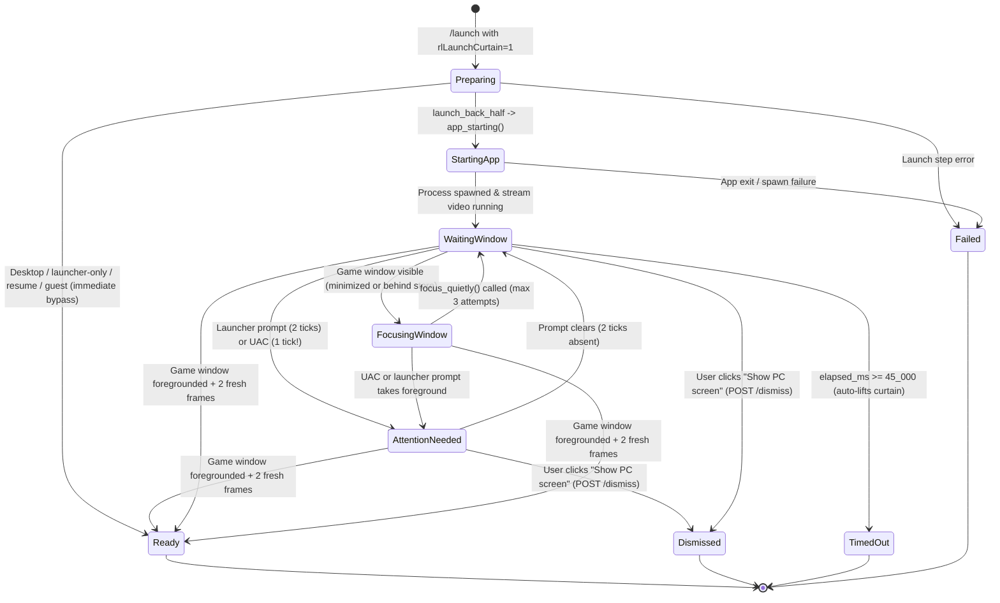

# Design 03: Launch Curtain & Smart Focus (Wave 1)

Status: design specification (Phase 0). Written against `main` `b3d0c26b9b` (`6.2.0`).

## 1. Summary & User Experience

Starting a Windows PC game remotely today exposes a rough seam: the Moonlight video stream connects within a second, then streams 5–30 seconds of Windows desktop, taskbar flashes, Steam/Epic/EA/Ubisoft/Xbox splash windows, or a game minimized behind its store client (`launch_focus.rs`, issue #131).

**Launch Curtain & Smart Focus** builds directly on the existing host watchers (`rust/host/src/launch_focus.rs`, `rust/host/src/launcher_watch.rs`, `rust/core/src/launcher_prompt.rs`) and Nightjar's calm connecting window (`client/app/src/main/java/com/limelight/ui/ConnectingScreen.java` and its desktop counterpart) to turn PC game launch into a console-clean transition — without ever automating clicks or keystrokes inside store launchers:

1. **Calm client-rendered launch curtain (zero fake progress bars).**
   - When launching a game on a capable host (`HostCapabilities::Feature::LaunchCurtain`), Nightjar sends `rlLaunchCurtain=1` on `/launch` and keeps its existing `ConnectingScreen` (game cover + baked ambient + moon orbit + one real protocol stage word) seamlessly extended after video packets start arriving.
   - The single stage word follows real host milestones over reliable control message `0x5548` (`LAUNCH_CURTAIN_STATE_MESSAGE_TYPE`): `"Connecting"` -> `"Preparing PC"` (`Preparing`) -> `"Starting game"` (`StartingApp`) -> `"Opening window"` (`WaitingWindow`) -> `"Focusing game"` (`FocusingWindow`) -> instant lift (`Ready`). There is **never** a fake percentage or timed progress bar.
   - Video decodes silently behind the curtain on the normal low-latency path; the moment the host sends `Phase::Ready` (the game's real top-level window is foregrounded and has presented fresh frames), Nightjar removes the curtain window immediately with zero holdback animation and zero stream-time layers.

2. **Smart Focus built directly on `launch_focus.rs`.**
   - While the curtain is active, the watcher polls at 250 ms (dropping back to `launch_focus::EVERY = 2s` once the curtain lifts) to detect the game's unowned, uncloaked, non-tool top-level window and bring it forward quietly (`butterpollo_windows::lossless::focus_quietly`) if minimized or sitting behind a store client (Steam, Epic, EA, Ubisoft, Xbox).
   - **Strict lock-ordering rule:** `current_app` is NEVER held across process enumeration, window enumeration, image-path resolution, UAC desktop inspection, or `focus_quietly`. Every tick takes a `FocusSnapshot` + generation token, drops the lock, performs OS calls, re-acquires `try_current_app()`, and verifies `snapshot.generation` before committing any state transition or focus action.

3. **Immediate launcher-prompt & UAC surfacing (read-only, never auto-clicking).**
   - Extends `rust/core/src/launcher_prompt.rs` from Steam/Epic/EA/Ubisoft to also recognize **Xbox / Microsoft Store** (`xboxpcapp.exe`, `gamingservicesui.exe`, `gamelaunchhelper.exe`) and **Windows UAC / secure desktop** (`consent.exe` or active input desktop `"Winlogon"` via non-invasive `OpenInputDesktop` / `GetUserObjectInformationW`).
   - If a launcher asks for sign-in, two-factor auth, an update/download, a licence/settings prompt, or Windows raises UAC, the host **never clicks or types into it**. Instead it immediately sends `0x5548` `Phase::AttentionNeeded` with structured launcher ID, prompt kind, and clipped window title (`<= 120` chars).
   - Nightjar immediately transitions the curtain into a calm plain-English action card (e.g., *"Steam wants you to sign in"*, *"Epic Games is updating"*, *"Windows needs administrator approval on this PC"*) with two choices: **Show PC screen** (lifts the curtain immediately so the player can interact directly with remote mouse/keyboard/touch) and **Cancel** (returns cleanly).

4. **Instant escape hatch & automatic bypasses.**
   - **Back / B / Esc / Cancel** cancels a launch before the game is up; **Show PC screen** (Dismiss) is available immediately once video flows, lifting the curtain instantaneously and calling `POST /api/native/v1/session/curtain/dismiss` so the host stops curtain polling.
   - Launches that do not target a game window — Desktop app, launcher-only entries (`launcher_prompt::opens_launcher_itself`), `/resume` of an already-running game, guest joins, remote monitors, and input-only sessions — immediately report `Phase::Ready` (`is_desktop_or_launcher = true`) so the curtain lifts on the very first decoded frame.

---

## 2. Protocol, Native API & Capability Contract

All IDs, fields, routes, and capability names conform strictly to [`00-protocol-reservations.md`](00-protocol-reservations.md):

### Control message `0x5548` (`client/protocol/core/src/launch_curtain.rs`, `no_std`)

- **ID:** `0x5548` (`LAUNCH_CURTAIN_STATE_MESSAGE_TYPE`), registered in `client/protocol/core/src/ids.rs` under `RUBYLIGHT_7_CONTROL_IDS = 0x5548..=0x554F`.
- **Direction & Delivery:** Host -> Client, **Reliable** (ENet reliable channel).
- **Negotiation & Compatibility:**
  - `PROTOCOL_VERSION` is **unchanged**.
  - `/serverinfo` element: `<LaunchCurtainVersion>1</LaunchCurtainVersion>` (emitted when host `launch_curtain` feature is enabled in `rust/core/src/extensions.rs::Offered`).
  - RTSP `DESCRIBE`: `a=x-rl-control:...,0x5548` (only when client opted in via launch param `rlLaunchCurtain=1`).
  - Launch parameter: `rlLaunchCurtain=1` on `/launch` (ignored/absent for stock Moonlight and older Nightjar clients, which receive zero `0x5548` packets and behave byte-for-byte as before).

#### Binary wire layout (`LaunchCurtainState`, little-endian, version 1)

| Offset | Size | Field | Values / Invariants |
| --- | --- | --- | --- |
| `0` | 1 | `version` | `1` (version 0 rejected; future versions may append trailing bytes). |
| `1` | 1 | `phase` | `0=Preparing`, `1=StartingApp`, `2=WaitingWindow`, `3=FocusingWindow`, `4=AttentionNeeded`, `5=Ready`, `6=Dismissed`, `7=TimedOut`, `8=Failed` (unknown `>=9` decoded as `Ready` on older v1 clients so unknown phases never trap a user behind a curtain!). |
| `2` | 1 | `flags` | Bit 0 (`0x01`): `is_desktop_or_launcher`; Bit 1 (`0x02`): `first_frame_seen`; Bit 2 (`0x04`): `uac_secure_desktop`; Bit 3 (`0x08`): `dismissible` (1 once stream video is active). |
| `3` | 1 | `prompt_kind` | `0=None`, `1=Update`, `2=SignIn`, `3=Prompt`, `4=Uac` (unknown `>=5` decoded as `Prompt`). |
| `4` | 4 | `sequence` | `u32` LE monotonic sequence per session; client ignores messages with `sequence <= last_sequence`. |
| `8` | 4 | `elapsed_ms` | `u32` LE ms since launch start (diagnostic/timeout visibility only; never rendered as progress %). |
| `12` | 1 | `launcher_len` | `u8` UTF-8 byte length (`0..=32`, e.g. `"steam"`, `"epic"`, `"ea"`, `"ubisoft"`, `"xbox"`, `"windows"`). |
| `13` | 2 | `title_len` | `u16` LE UTF-8 byte length (`0..=256`, clipped on host to 120 Unicode chars). |
| `15` | 2 | `reason_len` | `u16` LE UTF-8 byte length (`0..=256`, plain-English error/timeout summary if `Failed`/`TimedOut`). |
| `17` | var | `launcher`, `title`, `reason` | Contiguous UTF-8 slices validated by `core::str::from_utf8`. Max total packet size `<= 562` bytes. |

### Native API v1 (`API_VERSION = 1` unchanged)

- **Feature string (`rust/core/native-api/src/lib.rs`):** `pub const LAUNCH_CURTAIN: &str = "session.launch_curtain";`
- **`GET /api/native/v1/session/curtain`** (paired TLS cert, requires `view` permission):
  ```json
  {
    "revision": 12,
    "active": true,
    "phase": "attention_needed",
    "dismissible": true,
    "elapsed_ms": 8420,
    "prompt": {
      "launcher": "steam",
      "kind": "sign_in",
      "window_title": "Steam Guard - Computer Authorization Required",
      "since_unix_ms": 1795221890123
    },
    "reason": null
  }
  ```
  - For non-owner callers, `prompt.window_title` is omitted (`""`) and `dismissible` is `false` (matching `Session::launcher` privacy rules).
- **`POST /api/native/v1/session/curtain/dismiss`** (paired TLS cert, requires `launch` permission and session ownership; request body `{}` with `#[serde(deny_unknown_fields)]`):
  - Transitions host curtain state to `Dismissed`, enqueues reliable `0x5548` `Phase::Dismissed`, and returns the updated `LaunchCurtainSnapshot` JSON.
  - Errors (matching `rust/core/native-api/src/error.rs`): `not_paired` (`403`), `permission_required` (`403`), `not_session_owner` (`409`), `no_session` (`409`).
- **Additive enum update (`rust/core/native-api/src/session.rs`):** Adds `LauncherKind::Uac` (`"uac"`); older clients deserialize `"uac"` into existing `#[serde(other)] LauncherKind::Unknown`, which displays as a generic prompt.

### Nightjar `HostCapabilities::Feature`

- **Rust (`client/protocol/client/src/http/capabilities.rs`):** `Feature::LaunchCurtain`, added to `Feature::ALL`, proven by `evidence.launch_curtain_version >= 1 || native.has("session.launch_curtain")`.
- **Java (`client/app/src/main/java/com/limelight/nvstream/http/HostCapabilities.java`):** `Feature.LAUNCH_CURTAIN(0)`, matching identical evidence rules.
- **Contract tests:** Recorded XML/JSON fixtures in `client/app/src/test/resources/protocol/capabilities/` verified by `capabilities_contract.rs`.

---

## 3. Architecture & <=800-LOC Module Plan

All new modules comply with `tools/arch_check.py`: `<= 800` LOC ceiling, `//!` / `/**` headers, no raw `Config` reads inside `rust/host/src/stream/**` outside `stream/config.rs`, and zero `Family::Rubylight` gating in `client/`.

### Grandfathered files in `tools/size_ratchet.json` and ceiling protection

| Existing File | `size_ratchet.json` Ceiling | Strategy to Avoid Growth |
| --- | --- | --- |
| `rust/host/src/stream/control.rs` `[verify post-sprint code-map.md]` | **2675** LOC | Add a 3-line poll/send hook calling `crate::launch_curtain::drain_outbound(&s)` on the reliable channel; keep all logic in new `rust/host/src/launch_curtain.rs`. |
| `rust/host/src/native_api.rs` `[verify post-sprint code-map.md]` | **853** LOC | Register two routes (4 lines) delegating to new `rust/host/src/native_api/curtain.rs`; keep `native_api.rs` <= 853 LOC (reclaim 4 blank/redundant lines or move helper). |
| `rust/host/src/state.rs` `[verify post-sprint code-map.md]` | **2247** LOC | Store `pub curtain: Arc<crate::launch_curtain::CurtainState>` (1 field) on `Session`/`Host`; all methods live in `rust/host/src/launch_curtain.rs`. |
| `rust/host/src/process.rs` `[verify post-sprint code-map.md]` | **2064** LOC | Expose existing `FocusSnapshot` + `launch_progress()` unchanged (0 net growth). |
| `rust/host/src/stream/video/run.rs` `[verify post-sprint code-map.md]` | **1956** LOC | Single 2-line notification (`s.curtain.note_fresh_frame()`) after a fresh non-repeat frame is encoded; zero blocking, zero locks. |
| `client/protocol/client/src/http/capabilities.rs` `[verify post-sprint code-map.md]` | **1257** LOC | Minimal additive enum variant + 3-line evidence read (audit post-sprint ceiling; keep net diff minimal). |
| `client/app/src/main/java/com/limelight/GameConnection.java` `[verify post-sprint code-map.md]` | **1942** LOC | Delegate all `0x5548` events, watchdog timer, and Dismiss button actions to new `LaunchCurtainController.java` (~240 LOC) so `GameConnection.java` does not grow. |
| `client/app/src/main/java/com/limelight/Game.java` `[verify post-sprint code-map.md]` | **1883** LOC | Untouched or 2-line lifecycle forward to `LaunchCurtainController`. |
| `client/app/src/main/java/com/limelight/nvstream/jni/MoonBridge.java` `[verify post-sprint code-map.md]` | Grandfathered | **Do NOT add JNI bindings here.** Per `client/docs/code-map.md`, new Rust-engine control-message JNI bindings belong on `RustBridge.java` (or a new `CurtainBridge.java` `<= 800` LOC). |
| `client/protocol/desktop/src/stream/connect.rs` `[verify post-sprint code-map.md]` | **1818** LOC | Append `rlLaunchCurtain=1` via helper in `nightjar-core` (2 lines); UI lives in new `ui/launch_curtain.rs`. |
| `client/protocol/desktop/src/strings/*.rs` (14 files) `[verify post-sprint code-map.md]` | **1750** LOC (0 headroom) | **Do NOT modify `strings/*.rs`.** Route all new Launch Curtain Desktop translations to `client/protocol/desktop/src/strings_70/<code>.rs` (canonical 7.0.0 overflow tables from Design 02). |

### Full module plan

| Path | Status | Est. LOC | Ownership |
| --- | --- | --- | --- |
| `client/protocol/core/src/ids.rs` `[verify post-sprint code-map.md]` | Modify | ~260 | Add `RUBYLIGHT_7_CONTROL_IDS = 0x5548..=0x554F`, register `0x5548`, keep `0x554F` in `RESERVED_CONTROL_IDS`. |
| `client/protocol/core/src/launch_curtain.rs` `[verify post-sprint code-map.md]` | New | ~220 | `//!` `no_std` wire codec (`LaunchCurtainState`, `CurtainPhase`, `PromptKind`, encode/decode + bounds + unit tests). |
| `rust/core/native-api/src/curtain.rs` `[verify post-sprint code-map.md]` | New | ~130 | `//!` `LaunchCurtainSnapshot`, `CurtainDismissRequest`, `CurtainPhase` serde types + fixture tests. |
| `rust/core/src/launcher_prompt.rs` `[verify post-sprint code-map.md]` | Modify | ~470 (<=800) | Add Xbox store client processes (`xboxpcapp.exe`, `gamingservicesui.exe`, `gamelaunchhelper.exe`) and UAC classification (`consent.exe` / secure desktop flag -> `LauncherKind::Uac` immediately, 0-second grace!). |
| `rust/core/src/launch_curtain.rs` `[verify post-sprint code-map.md]` | New | ~260 | `//!` Pure host state machine: phase transitions, 2-fresh-frame readiness gate, 45 s safety timeout, desktop/resume bypass, monotonic `sequence`. |
| `rust/windows/src/uac_probe.rs` `[verify post-sprint code-map.md]` | New | ~110 | `//!` Non-invasive secure-desktop detector (`OpenInputDesktop(0, false, DESKTOP_READOBJECTS)` + `GetUserObjectInformationW(UOI_NAME)` checking `"Winlogon"` / access-denied fallback + `consent.exe` check). Works on Win10 & Win11. |
| `rust/host/src/launch_curtain.rs` `[verify post-sprint code-map.md]` | New | ~290 | `//!` Lock-safe host coordinator unifying `launch_focus.rs` + `launcher_watch.rs` + `uac_probe.rs` on the housekeeping thread (250 ms while curtain active -> 2 s after lift), strictly releasing `current_app` before every Win32 call. |
| `rust/host/src/launch_focus.rs` `[verify post-sprint code-map.md]` | Modify | ~220 (<=800) | Reuse its `look()` / `game_windows()` / `is_store_client()` primitives cleanly with `launch_curtain.rs` (add Xbox to `store_client` via `launcher_of`). |
| `rust/host/src/launcher_watch.rs` `[verify post-sprint code-map.md]` | Modify | ~95 (<=800) | Feed `uac_probe` + Xbox windows into `Watch::look` and notify `launch_curtain.rs` without holding `current_app` during `launcher_windows()`. |
| `rust/host/src/native_api/curtain.rs` `[verify post-sprint code-map.md]` | New | ~140 | `//!` `GET /session/curtain` and `POST /session/curtain/dismiss` handlers with live permission & ownership checks. |
| `rust/host/src/nvhttp/launch.rs` `[verify post-sprint code-map.md]` | Modify | ~735 (<=800) | Parse `rlLaunchCurtain=1`, seed `LaunchCurtain` initial phase (`Preparing` -> `StartingApp`), and set bypass flag on `/resume`, guest join, or Desktop app. |
| `client/protocol/client/src/launch_curtain.rs` `[verify post-sprint code-map.md]` | New | ~190 | `//!` Client-side curtain state machine + 10 s post-first-frame watchdog auto-lift + monotonic sequence filter. |
| `client/protocol/desktop/src/ui/launch_curtain.rs` `[verify post-sprint code-map.md]` | New | ~230 | `//!` Desktop calm curtain & `AttentionNeeded` action card over egui (zero blur once lifted, dynamic input glyphs). |
| `client/protocol/desktop/src/strings_70/<code>.rs` (14 per-locale files from Design 02) `[verify post-sprint code-map.md]` | Modify | +~20 LOC each (<=800) | All 14 non-English Desktop translations for Launch Curtain stage words & attention cards (zero lines added to `strings/*.rs`). |
| `client/app/src/main/java/com/limelight/nvstream/jni/RustBridge.java` (or new `CurtainBridge.java` `<= 800` LOC) `[verify post-sprint code-map.md]` | Modify / New | <=800 | `/**` Android JNI bindings for `0x5548` launch-curtain callbacks off grandfathered `MoonBridge.java` per `client/docs/code-map.md`. |
| `client/app/src/main/java/com/limelight/ui/LaunchCurtainController.java` `[verify post-sprint code-map.md]` | New | ~240 | `/**` Android controller connecting `RustBridge` (or `CurtainBridge`) `0x5548` callbacks + 10 s watchdog + Dismiss POST to `ConnectingScreen.java`. |
| `client/app/src/main/java/com/limelight/ui/ConnectingScreen.java` `[verify post-sprint code-map.md]` | Modify | ~430 (<=800) | Add `showAttentionCard(launcher, kind, title, onShowScreen, onCancel)` and `setDismissible(boolean)` reusing existing `conn_panel` / `ActionSheet` layout. |

---

## 4. State Machine, Reconnect Matrix & Crash-Restore Journal

### Host & client launch curtain state machine



### Key timing & safety invariants

- **Readiness gate (`Phase::Ready`):** Requires (a) a non-owned, non-tool, non-cloaked top-level window matching the launched app's candidate PIDs is visible, not minimized, and is the foreground process (not obscured by a store client), AND (b) `stream/video/run.rs` has encoded at least **2 fresh non-repeat frames** after that foreground transition (prevents lifting on a 1-frame uninitialized black swapchain).
- **Zero-grace UAC surfacing:** Unlike generic launcher windows (`GRACE = 20s`, 2-tick streak), UAC (`consent.exe` / `"Winlogon"` desktop) triggers `AttentionNeeded(Uac)` on the **very first 250 ms tick** so the player is notified immediately rather than staring at a curtain.
- **Hard lock-order invariant:** `launch_curtain::tick` acquires `h.try_current_app()` ONLY to copy `FocusSnapshot` + `generation` and immediately drops it; all Win32 calls (`window_list::visible`, `foreground::active_process`, `image_path`, `uac_probe::is_uac_active`, `focus_quietly`) run lock-free; re-acquires `try_current_app()` only to verify `generation` matches before committing state. Unit test `launch_curtain_never_holds_current_app_during_os_calls` enforces this identically to `launch_focus.rs:117`.
- **Client-side failsafe watchdog:** If a stream has decoded video frames for `>= 10 s` without receiving a `0x5548` update (e.g., dropped control session or stalled watcher), Nightjar automatically lifts the curtain with a non-blocking notice so a player is NEVER permanently stuck behind a curtain.

### Reconnect & edge-case matrix

| Scenario | Host Action | Client Action |
| --- | --- | --- |
| **`/resume` of running game** | Sets `is_desktop_or_launcher = true`, emits `Ready` immediately on control connect. | Lifts curtain on first decoded video frame (no extra delay). |
| **Desktop / Steam Big Picture (`opens_launcher_itself`)** | Emits `Ready` immediately on first frame. | Lifts curtain on first decoded video frame. |
| **Client roams / reconnects mid-launch** | Control worker immediately pushes current `LaunchCurtainState` snapshot upon ENet peer attach. | Resyncs `sequence`, updates stage word or lifts immediately if `Ready`. |
| **Second device joins as guest** | Guests never trigger `WaitingWindow`; host sends `Ready` immediately for guest sessions. | Guest sees stream immediately without holding behind owner's curtain. |
| **App replaced mid-launch (user switches game)** | `snapshot.generation` mismatch aborts in-flight OS focus result; new launch starts fresh at `sequence = 1`. | Old session tears down cleanly; new `ConnectingScreen` opens with new game cover. |
| **User hits Back / Cancel during `WaitingWindow`** | Stream closes normally; host `terminate_on_pause` / normal teardown applies. | Cancels immediately and returns to Game/Home page. |
| **User hits "Show PC screen" (Dismiss)** | `POST /session/curtain/dismiss` marks `Dismissed`, sends `0x5548` `Dismissed`, stops 250 ms fast polling. | Removes `ConnectingScreen` window immediately (optimistic local lift even if POST is slow) and forwards input to PC. |
| **Win10, physical display, WGC, Desktop Duplication, D3D11, AMD AMF, NVIDIA NVENC** | `window_list::visible()`, `uac_probe`, `focus_quietly`, and `note_fresh_frame()` are completely capture- and encoder-agnostic. | Identical behaviour across all decoders and renderers. |

### Crash-restore journal

Launch Curtain & Smart Focus mutates **zero** persistent Windows display, audio, registry, or driver settings (only non-persistent window foreground activation via `focus_quietly`). Consequently, no host crash-restore journal entries are needed. If the host crashes while the curtain is up, ENet disconnect fires immediately on Nightjar and transitions `ConnectingScreen` into the Connection Error sheet with zero stuck window.

---

## 5. Settings & 10/10 Craft Plan

- **Fewer-settings rule:** Zero new Nightjar Settings rows and zero new Host Settings Home rows. On the host, a single diagnostic switch `launch_curtain` (bool) lives in `rust/core/src/config.rs`, `rust/host/src/console/settings.rs`, and `rust/web/src/lib/schema/video.ts` (filed in `ALWAYS_ON` / `Debug switches` once promoted after measurement).
- **Default-off gate where unmeasured:** `Config::launch_curtain()` defaults to **`false`** until the Wave 1 measurement suite (Section 7) proves 0% stuck-curtain incidents across Steam/Epic/EA/Ubisoft/Xbox/Desktop launches and `<= +50 ms` lift latency after the second presented game frame on both Win10 and Win11. Once gates clear, the default flips to `true` before tagging 7.0.0.
- **Plain-English error & attention states:**
  - `SignIn`: *"{Launcher} wants you to sign in"* — *"Show the PC screen to sign in with your controller, keyboard, or touch."*
  - `Update`: *"{Launcher} is updating this game"* — *"Wait for it to finish, or show the PC screen to check progress."*
  - `Prompt`: *"{Launcher} is showing a prompt"* — *"{window_title}"*
  - `Uac`: *"Windows is asking for administrator permission"* — *"Approve the prompt on the PC to continue launching."*
  - `TimedOut`: Curtain lifts automatically with a quiet 1-line toast: *"Showing PC screen — the game is still starting."*
  - Never names mods (Nucleus Co-op / ANR) or internal error codes; never says "Experimental".
- **Dynamic input glyphs:** Curtain footer and attention-card actions show `InputSource` glyphs (Remote: `OK` Show PC screen / `Back` Cancel; Pad: `A`/`✕` and `B`/`○`; Keyboard: `Enter` and `Esc`; Touch/Mouse: clean buttons, zero glyphs).
- **Zero stream-time blur:** `ConnectingScreen` is a separate Dialog removed via `dialog.dismiss()` the moment the curtain lifts; Desktop paints the curtain only while active and emits zero blur/extra layers once lifted.
- **15 locales parity:** All stage words (`Preparing PC`, `Starting game`, `Opening window`, `Focusing game`) and attention-card strings are added to all 15 Nightjar locales (`values-*/strings.xml` + `client/protocol/desktop/src/strings_70/<code>.rs` — canonical 7.0.0 overflow files from Design 02; never growing grandfathered `strings/*.rs`) and host `launch_curtain` setting label/description to all `rust/assets/locale/*.json`.

---

## 6. Disjoint Implementer Slices

Strictly non-overlapping file lists for Phase 3 `parallel()`:

| Slice | Parallelism | Exclusive Owned Files (Zero Overlap) |
| --- | --- | --- |
| **03-A: Wire Protocol, Native API Types & Core FSM** | Stage 1 (lands first) | `client/protocol/core/src/ids.rs`, `client/protocol/core/src/launch_curtain.rs`, `client/protocol/core/src/lib.rs`, `client/protocol/core/src/fuzz.rs`, `rust/core/native-api/src/curtain.rs`, `rust/core/native-api/src/session.rs`, `rust/core/native-api/src/lib.rs`, `rust/core/src/extensions.rs`, `rust/core/src/launch_curtain.rs`, `rust/core/src/launcher_prompt.rs`, `rust/core/src/config.rs`, `rust/core/src/lib.rs` |
| **03-B: Host Windows Probe, Curtain Coordinator & Routes** | Stage 2 (parallel with 03-C) | `rust/windows/src/uac_probe.rs`, `rust/windows/src/lib.rs`, `rust/host/src/launch_curtain.rs`, `rust/host/src/launch_focus.rs`, `rust/host/src/launcher_watch.rs`, `rust/host/src/native_api/curtain.rs`, `rust/host/src/native_api.rs`, `rust/host/src/extensions.rs`, `rust/host/src/nvhttp/launch.rs`, `rust/host/src/stream/control.rs`, `rust/host/src/stream/video/run.rs`, `rust/host/src/state.rs`, `rust/host/src/console/settings.rs`, `rust/host/src/stream/reconnect_tests/curtain_tests.rs` |
| **03-C: Nightjar Core Engine & Capabilities** | Stage 2 (parallel with 03-B) | `client/protocol/client/src/launch_curtain.rs`, `client/protocol/client/src/lib.rs`, `client/protocol/client/src/http/capabilities.rs`, `client/protocol/client/src/http/native.rs`, `client/protocol/client/src/control/events.rs`, `client/protocol/client/src/control/session.rs`, `client/app/src/main/java/com/limelight/nvstream/http/HostCapabilities.java`, `client/app/src/test/resources/protocol/capabilities/*`, `client/protocol/client/tests/control_messages_contract.rs`, `client/protocol/client/tests/capabilities_contract.rs` |
| **03-D: Nightjar Desktop Curtain UI & Console Schema** | Stage 3 (after 03-C; parallel with 03-E) | `client/protocol/desktop/src/ui/launch_curtain.rs`, `client/protocol/desktop/src/stream/connect.rs`, `client/protocol/desktop/src/app/session.rs`, `client/protocol/desktop/src/strings_70/*.rs` (per-locale `strings_70/<code>.rs`; never growing grandfathered `strings/*.rs`), `client/protocol/desktop/src/strings/tests.rs`, `rust/web/src/lib/schema/video.ts`, `rust/web/src/lib/schema/main.ts` |
| **03-E: Nightjar Android Curtain UI & JNI Bridge** | Stage 3 (after 03-C; parallel with 03-D) | `client/protocol/android/src/lib.rs`, `client/app/src/main/java/com/limelight/nvstream/jni/RustBridge.java` (or new `client/app/src/main/java/com/limelight/nvstream/jni/CurtainBridge.java` `<= 800` LOC — JNI bindings stay off grandfathered `MoonBridge.java` per `client/docs/code-map.md`), `client/app/src/main/java/com/limelight/ui/LaunchCurtainController.java`, `client/app/src/main/java/com/limelight/ui/ConnectingScreen.java`, `client/app/src/main/java/com/limelight/GameConnection.java`, `client/app/src/main/res/values*/strings.xml`, `client/app/src/test/java/com/limelight/ui/LaunchCurtainControllerTest.java` |

*Disjointness audit:* Zero files overlap across 03-A..03-E.

---

## 7. Verification & Measurement Plan

### Narrowest unit & interop tests (no GPU)

1. **Protocol & fuzzing:** `cargo test --manifest-path client/protocol/Cargo.toml -p rubylight-protocol -- launch_curtain ids fuzz` (round-trip every phase/flag/prompt, reject version 0 / invalid UTF-8 / oversized lengths, assert `0x554F` stays free).
2. **Host core & lock-order proof:**
   - `cargo test -p butterpollo-core --locked launch_curtain launcher_prompt extensions`
   - `cargo test -p butterpollo --locked launch_focus launch_curtain` — specifically verifies `launch_curtain_never_holds_current_app_during_os_calls` and generation-mismatch cancellation when an app is replaced mid-tick.
3. **Loopback reconnect & Nightjar interop:**
   - `cargo test -p butterpollo --locked stream::reconnect_tests::curtain_tests` (covers stock Moonlight untouched, `rlLaunchCurtain=1` full lifecycle, launcher prompt -> Dismiss -> Ready, roam resync, 45 s timeout, guest bypass, `/resume` bypass).
   - `cargo test -p butterpollo --locked stream::reconnect_tests::interop_tests` (real `nightjar-core` engine against host in one process).
   - `cargo test -p butterpollo --locked nvhttp::native_tests` (`GET /session/curtain`, `POST /session/curtain/dismiss`, owner vs non-owner, permission refusals).
4. **Client contracts & UI tests:**
   - `cargo test --manifest-path client/protocol/Cargo.toml -p nightjar-core --test control_messages_contract --test capabilities_contract`
   - `gradlew :app:testNonRootDebugUnitTest --tests com.limelight.ui.LaunchCurtainControllerTest --tests com.limelight.nvstream.jni.MoonBridgeControlMessagesTest`
   - `cargo test --manifest-path client/protocol/Cargo.toml -p nightjar-desktop -- ui::launch_curtain strings`
5. **Architecture & code map checks:** `python tools/arch_check.py`, `python tools/code_map.py check`, `cargo fmt -- --check`.

### Visual screenshot checks

- Capture Desktop (`shot.rs`) and Android (`ConnectingScreen` Robolectric / emulator shots) in `WaitingWindow` (calm cover + orbit + single stage word), `AttentionNeeded` (`SignIn`, `Update`, `Uac` action cards), and lifted streaming state across Night, Day, OLED, and High-Contrast themes at 360 dp phone and 1280×720 TV. Verify zero fake progress bar, >= 4.5:1 contrast, and clean dynamic input glyphs.

### Serialized idle-gated hardware measurement criteria

1. **Pre-flight idle gate:** Confirm `http://127.0.0.1:47989/serverinfo` reports `RustHostSessionCount == 0` and `RustHostPendingSessionCount == 0` and maintainer idle approval.
2. **Isolated host:** `butterpollo.exe --config-dir C:\tests\curtain --port 48123 --bind 127.0.0.1` (`virtual_display_layout = extended`, `dd_configuration_option = disabled`, `virtual_display_mode = disabled`, `launch_curtain = true`).
3. **Hardware tests (RX 7900 XT + Radeon 780M, WGC + Desktop Duplication + D3D11):**
   - Synthetic game window launch behind a simulated Steam window: confirm Smart Focus brings window forward, curtain lifts within **<= 50 ms** after the 2nd fresh presented frame, and **0%** launches remain stuck behind the curtain.
   - Simulated UAC / launcher sign-in prompt: confirm `AttentionNeeded` arrives on Nightjar within **<= 500 ms** (UAC) / **<= 600 ms** (2-tick launcher) and **Show PC screen** lifts within **<= 1 frame**.
   - Stream-time overhead with `BUTTERPOLLO_TIMING_RECORD=1` (`e2e.py`, 60 s after curtain lifts): **0.00 ms** added to convert/encode/present_to_sent p99 (watcher drops back to idle polling once lifted; zero stream-time layers on client).
4. **Abort rule:** **Exit code 3 from `e2e.py` or `check.ps1` means an AMD encoder hang — stop immediately and investigate; never retry.**
5. **NVIDIA & Win10 verification:** Verify Win10 compatibility of `uac_probe.rs` and `focus_quietly`; audit NVENC launch/session paths against NVIDIA headers/samples (never claim tested on NVIDIA GPU hardware).

---

## 8. Post-Discovery & 6.3.0 Rebase Addendum (Rubylight `#131` Silent Launchers)

- **Silent Store Launcher Startup (`#131`, Slices 03-A/03-B/03-D):** Deliver the missing silent-launcher half of `#131` alongside fullscreen focus recovery: add an opt-in `silent_launchers` host/app launch policy that pre-starts cold storefronts quietly where supported (`steam.exe -silent -nochatui -nofriendsui -applaunch <appid>` alongside Epic's existing `silent=true` and safe URI fallbacks) and minimizes leftover store windows immediately once `Phase::Ready` hands focus to the game.
- **Expanded Launcher & Anti-Cheat Bootstrapper Detection (`launcher_prompt.rs`):** Extend `launcher_prompt::launcher_of` beyond Steam/Epic/EA/Ubisoft/Xbox to classify Battle.net (`battle.net.exe`), GOG Galaxy (`galaxyclient.exe`), Rockstar (`launcher.exe`/`rockstarservice.exe`), Riot (`riotclientux.exe`), and HoYoPlay (`hoyoplay.exe`/`hyp.exe`), and treat known anti-cheat bootstrappers (`start_protected_game.exe`, `EAAntiCheat.GameServiceLauncher.exe`) as transient pre-game stages rather than premature exits during `WaitingWindow`. (Locked-PC `#117` display-power wake is owned directly by [`28-host-capture-gpu-and-power.md`](28-host-capture-gpu-and-power.md).)
