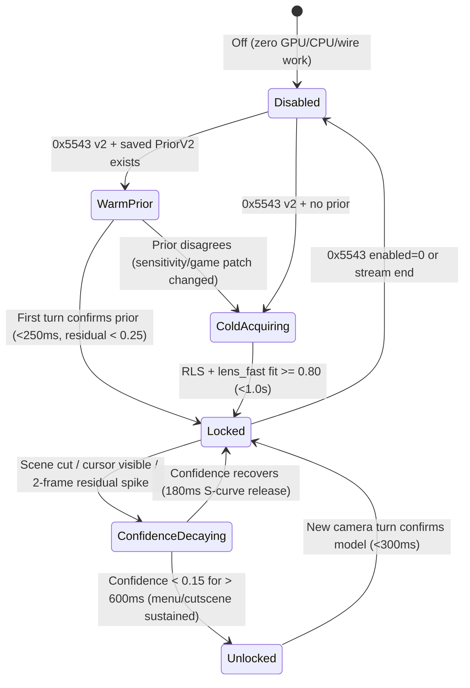

# Design 04: Frame Warp 2.0 (Wave 1)

Status: design specification (Phase 0). Written against `main` `b3d0c26b9b` (`6.2.0`).

## 1. Summary & User Experience

Frame Warp v1 (`0x5543..0x5546`, documented in `docs/frame-warp.md`) already removes most input-to-picture trail during mouse and right-stick camera turns using perspective lens reprojection (`Model::focal`) and a GPU-detected HUD mask. Real-world gameplay and `look_probe.rs` traces reveal four clear places where Frame Warp can feel dramatically tighter and cleaner:

1. **Sub-second convergence + richer per-game prior persistence.**
   - v1 requires `MIN_MOVES = 30`, `MIN_TRAVEL = 200`, `MIN_MOUSE_COUNTS = 300`, a 4-second batch window (`WINDOW_US = 4_000_000`), and ~7 seconds of turning to settle FOV (`lens.rs`), while `frame_warp.json` priors still require `RECENT_US = 1.2s` confirmation before locking.
   - Frame Warp 2.0 replaces slow batch-only lock-in with a **fast online recursive least-squares (RLS) estimator** paired with a **2-pass coarse + Gauss-Newton focal-length solver** and warm-start **per-game `PriorV2`** persistence (`frame_warp.json` v2: mouse gain, stick gain/deadzone/exponent, gyro gain, focal length, lag, and confidence timestamp).
   - Target user experience: cold-start lock in **< 1.0 s** of camera motion (400–800 ms typical) and warm-start re-lock from a saved game prior in **< 250 ms** on the very first turn.

2. **Unified angular-velocity model (Gyro + Right-Stick + Mouse).**
   - v1 tracks relative mouse deltas and controller right-stick deflection, leaving gyro-aiming players on DualSense, Switch Pro, Steam Deck, and Android handhelds unwarped during motion-aim turns.
   - Frame Warp 2.0 ingests controller gyro packets (`0x5500_0006` angular velocity `(gx, gy, gz)` in deg/s) into the host's input history and Nightjar's client predictor, unifying all three camera inputs into a single focal-normalized angular velocity vector $\boldsymbol{\omega}(t) = (\omega_{\text{yaw}}, \omega_{\text{pitch}})$:
     $$\Delta\boldsymbol{\theta}_{\text{in-flight}} = \frac{\mathbf{g}_m \odot (\mathbf{m}_{\text{sent}} - \mathbf{m}_{\text{tag}})}{f} + \int_{\tau_s}^{\text{now}} \frac{\mathbf{g}_s \odot \text{stick\_curve}(\mathbf{s}(t))}{f}\,dt + \int_{\tau_g}^{\text{now}} \frac{\mathbf{G}_g \cdot (\mathbf{g}_{\text{gyro}}(t) - \mathbf{b}_g)}{f}\,dt$$
     where $\mathbf{b}_g$ is the stationary gyro zero-rate bias, $f$ is the learned focal length (or 1.0 for flat/orthographic games), and $\tau_g$ is the client send timestamp of the last gyro packet reflected by the frame (`gyro_seq` + `gyro_held_us` in `0x5549`).

3. **Edge-safe disocclusion fill + refined HUD stability mask (zero crosshair/minimap smear).**
   - v1 mirrors pixels past screen borders (`1 - abs(1 - abs(p))`) with a linear 35% darken (`EDGE_DARKEN = 0.35`, `EDGE_RAMP = 0.08`), which creates visible doubled silhouettes when high-contrast geometry crosses an edge. And when a shifted pixel's source lands on a HUD cell (`frameWarpHud(source)`), v1 falls back directly to unshifted `q`, creating a "sticky halo" smear around crosshairs, minimaps, and weapon models.
   - Frame Warp 2.0 introduces:
     - **Edge-safe disocclusion fill:** replaces mirrored doubling with clamped border-tangent sampling + 3-tap tangential soft blur + smooth cubic vignette decay (`smoothstep`), eliminating hall-of-mirrors silhouettes while preserving clean edge cues (applied in linear/gamma-safe luminance so HDR PQ/HLG/Dolby Vision streams never shift hue).
     - **Refined HUD stability mask & 2-tap reverse-disocclusion unclogging:** On the host GPU, `compute_frame_warp_v2.rs` adds temporal gradient consistency + stability confidence scoring (protecting thin 1–2 px crosshairs and semi-transparent minimap borders against flicker) with tighter morphological joining. On every client shader (D3D11, SDL GPU, Metal, Android GLES, Android Vulkan), when `source` lands inside a HUD cell, the shader probes up to 2 taps along the reverse shift direction (`source - k * step`) to find the nearest valid background texel before falling back to `q`, cleanly removing ghost cutouts beside crosshairs and minimaps.

4. **Confidence-gated smooth decay on cutscenes, menus, and pauses.**
   - v1 waits `RECENT_US = 1.2 s` before unlocking when a player opens a pause menu, triggers a cutscene, or reveals a cursor — producing up to a full second of wrong-direction warping.
   - Frame Warp 2.0 transmits per-frame real-time confidence and scene-state hints via unreliable control message **`0x5549` (`FRAME_WARP_V2_META_MESSAGE_TYPE`)**. A scene cut (thumbnail luma histogram/correlation collapse), visible OS cursor (`cursor_shape` state), or 2-frame residual spike immediately drops `camera_confidence`, which the client tracks through an asymmetric envelope (**40 ms** exponential attack on drop, **180 ms** smooth S-curve release on re-lock). Opening a pause menu or entering a cutscene smoothly halts warping in under 100 ms with zero jump.

---

## 2. Protocol, Native API & Capability Contract

All IDs, versions, and capability names match [`00-protocol-reservations.md`](00-protocol-reservations.md) verbatim:

| Surface | Contract |
| --- | --- |
| `PROTOCOL_VERSION` | **Unchanged.** Stock Moonlight clients never send `0x5543` and pay zero cost. |
| `rubylight_native_api::API_VERSION` | **Unchanged (`1`).** No new native API routes needed. |
| `/serverinfo` element | `<FrameWarpVersion>2</FrameWarpVersion>` (v1 clients check `>= 1` and negotiate v1 seamlessly). |
| RTSP `DESCRIBE` | `a=x-rl-control:...,0x5543,0x5544,0x5545,0x5546,0x5549` (only when `frame_warp` is offered by host). |
| Control ID `0x5543` (`FrameWarpRequest`) | Backward-compatible v2 extension: byte 0 `version = 2` (v1 clients send `version = 1` and 8 bytes; v2 clients send `version = 2` and 12 bytes). |
| Control ID `0x5544..=0x5546` | Existing `Model` (reliable), `Tags` (unreliable), `Mask` (reliable) kept wire-identical for both v1 and v2 clients! |
| Control ID **`0x5549`** | **`frame_warp::FRAME_WARP_V2_META_MESSAGE_TYPE`**, registered in `RUBYLIGHT_7_CONTROL_IDS` (`0x5548..=0x554F`). Direction: **Host -> Client**, Delivery: **Unreliable**, sent ONLY to clients whose `0x5543` request carried `version >= 2`. |
| Nightjar `HostCapabilities::Feature` | Rust `Feature::FrameWarpV2` (`client/protocol/client/src/http/capabilities.rs`) + Java `HostCapabilities.Feature.FRAME_WARP_V2` (`HostCapabilities.java`), proven strictly by `FrameWarpVersion >= 2`. Never brand-gated. |

### Wire format: `FrameWarpRequest` v2 (`0x5543`, Client -> Host, Reliable, 12 bytes)

| Offset | Size | Field | Meaning |
| --- | --- | --- | --- |
| `0..8` | 8 | v1 prefix | Byte 0: `version = 2`; Byte 1: `enabled` (`0\|1`); Byte 2: `controller` (`0..=15` or `0xFF`); Byte 3: `flags` (`bit0=lens`, `bit1=gyro`, `bit2=edge_disocclusion_v2`, `bit3=confidence_decay_v2`); Bytes 4..6: `mask_max_width` (`u16` LE); Bytes 6..8: `0`. |
| `8` | 1 | `gyro_controller` | Controller index `0..=15` providing gyro `0x5500_0006` packets, or `0xFF` = same as `controller` (or none if `bit1==0`). |
| `9` | 1 | `gyro_axes` | Bit 0: invert yaw; Bit 1: invert pitch; Bits 2..3: yaw source (`0=Y`, `1=Z`, `2=auto-fit`). |
| `10..12` | 2 | `max_offset_milli` | `u16` LE optional client clamp as thousandths of picture width (`0` = host default `150` = 15%). |

*Backward compatibility:* v1 `FrameWarpRequest::decode` already accepts `version >= 1` and ignores trailing bytes (`client/protocol/core/src/frame_warp.rs:125`). When a host receives `version == 1`, it disables v2 extensions and NEVER emits `0x5549`.

### Wire format: `FrameWarpV2Meta` (`0x5549`, Host -> Client, Unreliable, 40 bytes)

| Offset | Size | Field | Type / Units |
| --- | --- | --- | --- |
| `0` | 1 | `version` | `u8` = `2` (0 rejected; trailing bytes in future versions ignored). |
| `1` | 1 | `flags` | Bit 0: `gyro_locked`; Bit 1: `scene_cut`; Bit 2: `cursor_visible_pause`; Bit 3: `hud_soft_edge`; Bit 4: `prior_warm_locked`; Bit 5: `disocclusion_v2`. |
| `2` | 2 | `model_generation` | `u16` LE matching `Model::generation` and `Tags::model_generation`. |
| `4` | 4 | `frame` | `u32` LE video frame number matching `Tag::frame`. |
| `8` | 2 | `camera_confidence` | `u16` LE normalized `0..=65535` (`0.0..=1.0`) instantaneous confidence gate. |
| `10` | 2 | `hud_stability` | `u16` LE normalized `0..=65535` (`0.0..=1.0`) HUD mask reliability score. |
| `12` | 4 | `gyro_seq` | `u32` LE wrapping sequence of last reflected `0x5500_0006` gyro packet (`0` if none). |
| `16` | 4 | `gyro_held_us` | `u32` LE microseconds held since `gyro_seq` (`0xFFFF_FFFF` = `HELD_NONE`). |
| `20` | 4 | `gyro_gain_x` | `f32` LE picture centre px per radian of yaw (finite, `|g| <= MAX_GAIN`). |
| `24` | 4 | `gyro_gain_y` | `f32` LE picture centre px per radian of pitch (finite, `|g| <= MAX_GAIN`). |
| `28` | 4 | `omega_x_mrad_s` | `i32` LE filtered host camera yaw angular velocity (milliradians/sec). |
| `32` | 4 | `omega_y_mrad_s` | `i32` LE filtered host camera pitch angular velocity (milliradians/sec). |
| `36` | 1 | `edge_fade_strength` | `u8` (`0..=255`, default `90` ≈ 35% soft edge vignette). |
| `37` | 1 | `hud_guard_px` | `u8` (`0..=8`, reverse-disocclusion probe radius in mask cells, default `2`). |
| `38` | 2 | `reserved` | `u16` LE (`0`). |

---

## 3. Architecture & <=800-LOC Module Plan

All new modules obey `tools/arch_check.py`: `<= 800` LOC ceiling, `//!` / `/**` headers, no raw `Config` reads in `rust/host/src/stream/**` outside `stream/config.rs`, zero `Family::Rubylight` gating in `client/`, and mandatory Metal shader regeneration via `client/protocol/desktop/src/metal/generate.py` whenever any `.spv` changes.

### Grandfathered & near-ceiling files in `tools/size_ratchet.json`

| Existing File | Current / Ceiling LOC | Strategy to Avoid Growth |
| --- | --- | --- |
| `rust/core/src/frame_warp/calibrate.rs` `[verify post-sprint code-map.md]` | **797** / **800** (NOT grandfathered — 3 lines headroom!) | **Do NOT add v2 logic here.** Place all v2 RLS estimation, gyro calibration, and warm-prior lock logic into new sibling modules `rls.rs`, `gyro.rs`, `confidence.rs`, and `lens_fast.rs`. |
| `client/protocol/core/src/frame_warp.rs` `[verify post-sprint code-map.md]` | **851** ceiling | Place `FrameWarpV2Meta`, `RequestV2`, and angular-velocity math in new `client/protocol/core/src/frame_warp_v2.rs` (~260 LOC); `frame_warp.rs` only re-exports `FRAME_WARP_V2_META_MESSAGE_TYPE`. |
| `rust/core/src/frame_warp/mod.rs` `[verify post-sprint code-map.md]` | **878** ceiling | Delegate v2 state, gyro tracking, and `0x5549` assembly to a composed `v2: Option<V2State>` in new `rust/core/src/frame_warp/v2.rs` (~280 LOC); `mod.rs` stays <= 878 LOC. |
| `rust/core/src/frame_warp/motion.rs` `[verify post-sprint code-map.md]` | **892** ceiling | Read existing `Motion` + `cells` directly from `confidence.rs` and `lens_fast.rs`; zero growth in `motion.rs`. |
| `rust/windows/src/compute_frame_warp.rs` `[verify post-sprint code-map.md]` | **818** ceiling | Put v2 HUD stability scoring shader constants & dispatch helper in new `rust/windows/src/compute_frame_warp_v2.rs` (~210 LOC); `compute_frame_warp.rs` stays <= 818 LOC. |
| `client/protocol/desktop/src/stream/frame_warp.rs` `[verify post-sprint code-map.md]` | **991** ceiling | Put v2 shader-row packing (`warpV2` constant buffer row) and edge-disocclusion SDL mesh helper in new `stream/frame_warp_v2.rs` (~220 LOC); `stream/frame_warp.rs` stays <= 991 LOC. |
| `client/protocol/desktop/src/stream/d3d11.rs` / `render.rs` `[verify post-sprint code-map.md]` | **1125** / **1728** ceiling | Pass `WarpDraw::v2_row()` (4 floats) in existing constant buffer struct with 2-line hook; zero structural growth. |
| `client/app/src/main/java/com/limelight/binding/video/GlesUpscaler.java` `[verify post-sprint code-map.md]` | **829** (watch ceiling!) | Place v2 uniform upload and `warpOutV2` parsing in new `GlesFrameWarpV2.java` (~150 LOC); `GlesUpscaler.java` delegates in 2 lines. |
| `client/app/src/main/jni/vulkan/vulkan_renderer.cpp` / `pyrowave_renderer.cpp` `[verify post-sprint code-map.md]` | **3575** / **4055** ceiling | Place push-constant v2 packing in new header `frame_warp_v2_pc.h` (~90 LOC) included by both renderers; net growth <= 4 lines per `.cpp`. |
| `client/protocol/desktop/src/strings/*.rs` (14 files) `[verify post-sprint code-map.md]` | **1750** ceiling (0 headroom) | **Do NOT edit `strings/*.rs`.** Route all new Frame Warp 2.0 Desktop translations exclusively to the canonical 7.0.0 overflow files `client/protocol/desktop/src/strings_70/<code>.rs` (established in Design 02, each `<= 800` LOC). |

### Full module plan

| Path | Status | Est. LOC | Ownership |
| --- | --- | --- | --- |
| `client/protocol/core/src/ids.rs` `[verify post-sprint code-map.md]` | Modify | ~265 | Register `0x5549` (`FRAME_WARP_V2_META_MESSAGE_TYPE`) in `RUBYLIGHT_7_CONTROL_IDS`. |
| `client/protocol/core/src/frame_warp_v2.rs` `[verify post-sprint code-map.md]` | New | ~260 | `//!` `no_std` `RequestV2`, `FrameWarpV2Meta`, `V2Flags`, angular-velocity normalization helpers, unit tests. |
| `rust/core/src/frame_warp/rls.rs` `[verify post-sprint code-map.md]` | New | ~280 | `//!` Fast online RLS gain/lag estimator with adaptive forgetting (`lambda = 0.94..0.99`) and warm-start prior fusion (<1.0 s cold lock, <250 ms warm lock). |
| `rust/core/src/frame_warp/gyro.rs` `[verify post-sprint code-map.md]` | New | ~230 | `//!` Controller gyro (`0x5500_0006`) history buffer, stationary bias estimator, yaw/pitch auto-axis sign calibration, and angular integral queries. |
| `rust/core/src/frame_warp/confidence.rs` `[verify post-sprint code-map.md]` | New | ~190 | `//!` Instant scene-cut detector (luma histogram/correlation drop), cursor-visibility gate, 2-frame residual spike detector, and confidence score generator. |
| `rust/core/src/frame_warp/lens_fast.rs` `[verify post-sprint code-map.md]` | New | ~240 | `//!` Fast 2-pass FOV estimator (6° coarse sweep + 3-step Gauss-Newton parabola refinement) locking in <= 12 turning moves (~0.5 s at 60 fps). |
| `rust/core/src/frame_warp/v2.rs` `[verify post-sprint code-map.md]` | New | ~260 | `//!` Composes `rls`, `gyro`, `confidence`, and `lens_fast` inside `FrameWarpHost`, produces `FrameWarpV2Meta` (`0x5549`) per tagged frame. |
| `rust/windows/src/compute_frame_warp_v2.rs` `[verify post-sprint code-map.md]` | New | ~210 | `//!` Refined HUD stability-score & edge-gradient consistency pass helper on D3D12 compute queue (leaves D3D11/WGC/DDX/AMF/NVENC capture interfaces untouched; fails visibly with WARN if D3D12 compute is unavailable). |
| `rust/host/src/stream/frame_warp_prior.rs` `[verify post-sprint code-map.md]` | New | ~180 | `//!` `frame_warp.json` v2 atomic store (auto-migrates v1 priors, adds gyro gain + prior confidence timestamp + schema version, LRU 256 games). |
| `client/protocol/client/src/frame_warp_v2.rs` `[verify post-sprint code-map.md]` | New | ~290 | `//!` Client unified angular-velocity predictor (mouse + stick + gyro), asymmetric confidence decay envelope (40 ms down / 180 ms up), and `0x5549` handling. |
| `client/protocol/desktop/src/stream/frame_warp_v2.rs` `[verify post-sprint code-map.md]` | New | ~220 | `//!` Desktop presenter `warpV2` constant-buffer packing (`[edge_fade, hud_guard_px, confidence, flags]`) and edge-safe SDL mesh builder. |
| `client/protocol/desktop/src/frame_warp.hlsl` `[verify post-sprint code-map.md]` | Modify | ~115 | Edge-safe disocclusion fill (clamped tangent 3-tap soft fill + smoothstep vignette) + 2-tap reverse-motion HUD border unclogging; recompile `.spv` & regenerate `metal/*.metal` via `metal/generate.py`. |
| `client/app/src/main/java/com/limelight/binding/video/GlesFrameWarpV2.java` `[verify post-sprint code-map.md]` | New | ~150 | `/**` GLES v2 uniform bridge (`uWarpV2`) keeping `GlesUpscaler.java` flat. |
| `client/app/src/main/assets/shaders/warp.frag` `[verify post-sprint code-map.md]` | Modify | ~95 | GLES port of edge-safe disocclusion fill & 2-tap HUD border unclogging. |
| `client/app/src/main/jni/vulkan/shaders/video_warp.frag` & `pyrowave-renderer/shaders/frame_warp.glsl` `[verify post-sprint code-map.md]` | Modify | ~100 each | Vulkan ports + regenerate `shaders_spv.h` via `compile_shaders.sh` (`PyroWaveVulkanFloorTest` verified). |

---

## 4. State Machine, Reconnect Matrix & Crash-Restore Journal

### Calibration & confidence state machine

### Reconnect, codec & platform compatibility matrix

| Scenario | Behaviour |
| --- | --- |
| **v2 Client <-> v2 Host** | Negotiates `0x5543` (`version = 2`), enables `0x5549`, fast RLS, gyro integration, edge-safe disocclusion, and confidence decay. |
| **v1 Client <-> v2 Host** | Host sees `0x5543` (`version = 1`), suppresses `0x5549`, sends standard v1 `Model`/`Tags`/`Mask` byte-for-byte identically to 6.2.0. |
| **v2 Client <-> v1 Host (`FrameWarpVersion == 1`)** | Client sees `!capabilities.has(Feature::FrameWarpV2)`, sends `0x5543` (`version = 1`), runs v1 predictor cleanly without expecting `0x5549`. |
| **Stock Moonlight <-> v2 Host** | Never sends `0x5543`; host allocates zero GPU passes, spawns zero worker thread, adds **0.00 ms** latency. |
| **Client roam / reconnect** | New `0x5543` resets mouse/pad/gyro input counters on both ends; host immediately loads `PriorV2` from `frame_warp.json` and re-locks in `< 250 ms`. |
| **Mid-stream reconfigure (`0x5532`)** | Rescales pixel gains proportionally to new content size while preserving FOV tangent invariant; resets HUD buffer cleanly with fence-safe retirement (`retired` ring). |
| **Pause menu / OS cursor appears** | `cursor_shape` visibility sets `CURSOR_VISIBLE_PAUSE` flag in `0x5549`; client confidence decays smoothly to `0.0` within 40 ms (no wrong-direction warp while moving a menu cursor!). |
| **HDR (PQ / HLG / Dolby Vision) & PyroWave** | Edge vignette operates in normalized display-safe darkening without corrupting HDR transfer primaries; PyroWave Vulkan & Desktop presenters share identical `frame_warp.hlsl` / `frame_warp.glsl` math. |
| **AMD AMF, NVIDIA NVENC, Win10, physical displays, WGC, Desktop Duplication, D3D11** | GPU passes run on the capture GPU's D3D12 compute queue after encode submission (`FrameWarpGpu::submit`, never CPU-blocking). If D3D12 compute is unavailable on a D3D11-only environment, host logs a loud WARN and refuses Frame Warp cleanly (never silently degrades capture/encode). NVENC paths are verified against vendor headers/samples only (never claimed tested on NVIDIA HW). |

### Crash-restore journal

Frame Warp 2.0 mutates **zero** OS display, audio, or driver state and needs no host OS crash-restore journal. `frame_warp.json` (`frame_warp_prior.rs`) writes atomically via temp file + `rename` only on worker shutdown or periodic 60 s checkpoint. On load, any corrupt/truncated JSON logs a WARN, renames the broken file to `frame_warp.json.corrupt`, and falls back cleanly to cold calibration.

---

## 5. Settings & 10/10 Craft Plan

- **Fewer-settings rule:** **Zero** new user-facing settings on either host or Nightjar!
  - Nightjar keeps its single **Video → Frame Warp** toggle (no "v1 vs v2", no gyro-warp sub-toggle, no edge-fill mode picker — all upgrades activate automatically when both ends support `FrameWarpV2`).
  - Host keeps its single `frame_warp` toggle in `ALWAYS_ON` / Debug switches.
- **Default-off gate where unmeasured:** Nightjar's **Frame Warp** toggle stays **default-off** (`false`) until the Section 7 ABBA measurements on **both RX 7900 XT and Radeon 780M** clear every accuracy, convergence, HUD-artifact, and GPU timing threshold. Only if every gate passes is default-on even considered (with an explicit maintainer sign-off and `rust/PERFORMANCE.md` record).
- **Plain-English error states:** If the host cannot initialize compute passes on the capture GPU, or if a stream mode cannot run Frame Warp, the host logs a clear WARN and reports `active = false` so Nightjar's stats overlay displays *"Frame Warp unavailable on this stream"* rather than silently claiming active.
- **Dynamic input glyphs & zero stream-time blur:** Frame Warp telemetry lines in the stats overlay (`Frame Warp: Locked (96%, Gyro+Mouse, 28 ms lag)`) render inside the existing zero-blur `glass.menu.hud` capsule; zero extra layers or blur passes are added.
- **Zero "Experimental" & zero mod names:** Automated tests confirm neither `"Experimental"` nor any mod name appears in Frame Warp labels, help strings, or overlay diagnostics.
- **15 locales parity:** Any updated Frame Warp description (two short sentences: what the player gets, what it costs, when to change it) and stats labels are translated across all 15 Nightjar locales (`values-*/strings.xml` + `client/protocol/desktop/src/strings_70/<code>.rs` — never growing grandfathered `strings/*.rs` past 1,750 LOC) and verified by `scripts/generate-settings.py`.

---

## 6. Disjoint Implementer Slices

Strictly non-overlapping file lists for Phase 3 `parallel()`:

| Slice | Parallelism | Exclusive Owned Files (Zero Overlap) |
| --- | --- | --- |
| **04-A: Wire Protocol & Capabilities** | Stage 1 (lands first) | `client/protocol/core/src/ids.rs`, `client/protocol/core/src/frame_warp_v2.rs`, `client/protocol/core/src/frame_warp.rs`, `client/protocol/core/src/lib.rs`, `client/protocol/core/src/fuzz.rs`, `rust/core/src/extensions.rs`, `client/protocol/client/src/http/capabilities.rs`, `client/app/src/main/java/com/limelight/nvstream/http/HostCapabilities.java`, `client/app/src/test/resources/protocol/capabilities/*`, `client/protocol/client/tests/control_messages_contract.rs`, `client/protocol/client/tests/capabilities_contract.rs` |
| **04-B: Host Core Math & Estimators** | Stage 2 (parallel with 04-D) | `rust/core/src/frame_warp/rls.rs`, `rust/core/src/frame_warp/gyro.rs`, `rust/core/src/frame_warp/confidence.rs`, `rust/core/src/frame_warp/lens_fast.rs`, `rust/core/src/frame_warp/v2.rs`, `rust/core/src/frame_warp/mod.rs` |
| **04-C: Host GPU Passes, Priors & Stream Wiring** | Stage 3 (after 04-B; parallel with 04-E, 04-F) | `rust/windows/src/compute_frame_warp_v2.rs`, `rust/windows/src/compute_frame_warp.rs`, `rust/windows/src/shaders/color.hlsl`, `rust/windows/build_shaders.rs`, `rust/host/src/stream/frame_warp_prior.rs`, `rust/host/src/stream/frame_warp.rs`, `rust/host/src/stream/control.rs`, `rust/host/src/extensions.rs`, `rust/host/src/stream/reconnect_tests/frame_warp_v2_tests.rs` |
| **04-D: Nightjar Core Predictor** | Stage 2 (parallel with 04-B) | `client/protocol/client/src/frame_warp_v2.rs`, `client/protocol/client/src/frame_warp.rs`, `client/protocol/client/src/control/events.rs`, `client/protocol/client/src/control/session.rs`, `client/protocol/client/src/input/queue.rs` |
| **04-E: Desktop Presenters, HLSL/SPIR-V & Metal** | Stage 3 (after 04-D; parallel with 04-C, 04-F) | `client/protocol/desktop/src/stream/frame_warp_v2.rs`, `client/protocol/desktop/src/stream/frame_warp.rs`, `client/protocol/desktop/src/frame_warp.hlsl`, `client/protocol/desktop/src/upscale.spv`, `client/protocol/desktop/src/pyrowave.spv`, `client/protocol/desktop/src/pyrowave-planes.spv`, `client/protocol/desktop/src/packed444.spv`, `client/protocol/desktop/src/metal/*.metal`, `client/protocol/desktop/src/stream/d3d11.rs`, `client/protocol/desktop/src/stream/render.rs`, `client/protocol/desktop/src/strings_70/*.rs` (per-locale `strings_70/<code>.rs`; never modifying grandfathered `strings/*.rs`), `client/protocol/desktop/src/strings/tests.rs` |
| **04-F: Android JNI, GLES & Vulkan Shaders** | Stage 3 (after 04-D; parallel with 04-C, 04-E) | `client/protocol/android/src/lib.rs`, `client/app/src/main/java/com/limelight/nvstream/jni/MoonBridge.java`, `client/app/src/main/java/com/limelight/binding/video/GlesFrameWarpV2.java`, `client/app/src/main/java/com/limelight/binding/video/GlesUpscaler.java`, `client/app/src/main/assets/shaders/warp.frag`, `client/app/src/main/jni/vulkan/frame_warp_v2_pc.h`, `client/app/src/main/jni/vulkan/shaders/video_warp.frag`, `client/app/src/main/jni/vulkan/vulkan_renderer.cpp`, `client/app/src/main/jni/pyrowave-renderer/shaders/frame_warp.glsl`, `client/app/src/main/jni/pyrowave-renderer/pyrowave_renderer.cpp`, `client/app/src/main/jni/pyrowave-renderer/shaders_spv.h`, `client/app/src/main/res/values*/strings.xml` |

*Disjointness audit:* Zero files overlap across 04-A..04-F. Every `.spv` update in 04-E includes its regenerated `metal/*.metal` in the same slice (`metal/generate.py`), and every Android Vulkan shader edit in 04-F includes its regenerated `shaders_spv.h`.

---

## 7. Verification & Measurement Plan

### Narrowest unit, shader & interop checks (no GPU)

1. **Wire protocol & fuzzing:** `cargo test --manifest-path client/protocol/Cargo.toml -p rubylight-protocol -- frame_warp ids fuzz` (roundtrip v1 & v2 requests, `0x5549`, out-of-bounds NaN/Inf rejections, `0x554F` free).
2. **Host core math (synthetic deterministic camera + gyro + HUD + cutscene simulator):**
   - `cargo test -p butterpollo-core --locked frame_warp`
   - Must prove: cold lock `< 1.0 s` on synthetic 60 fps mouse/stick/gyro turns, warm prior lock `< 0.25 s`, focal length within `<= 2.5°` of ground truth across 60°/90°/110° FOV in `<= 15` moves, and cutscene/cursor confidence drop to `< 0.1` within `<= 80 ms`.
3. **Nightjar core & interop:**
   - `cargo test --manifest-path client/protocol/Cargo.toml -p nightjar-core -- frame_warp control_messages_contract capabilities_contract`
   - `cargo test -p butterpollo --locked stream::reconnect_tests::frame_warp_v2_tests stream::reconnect_tests::interop_tests` (verifies v2<->v2, v1<->v2, v2<->v1, and stock Moonlight zero-packet invariance).
4. **Desktop & Android shader/build parity:**
   - `cargo test --manifest-path client/protocol/Cargo.toml -p nightjar-desktop -- stream::shader stream::frame_warp strings` (asserts every `.spv` SHA-256 matches its `metal/*.metal` header from `metal/generate.py`, and verifies `strings_70` literal coverage).
   - `gradlew :app:testNonRootDebugUnitTest --tests com.limelight.nvstream.jni.MoonBridgeControlMessagesTest --tests com.limelight.binding.video.PyroWaveVulkanFloorTest` and `gradlew :app:externalNativeBuildNonRootDebug`.
5. **Architecture & code map gates:** `python tools/arch_check.py`, `python tools/code_map.py check`, `cargo fmt -- --check`.

### Visual artifact checks (offline shader & probe captures)

- Run synthetic `look_probe.rs` scenes containing a high-contrast vertical stripe at the screen edge, a 2 px center crosshair, and a corner minimap across D3D11, SDL GPU, Metal (CI), Android GLES, and Android Vulkan. Inspect output frames to verify:
  - Zero mirror-doubled edge silhouettes during 12% shift turns.
  - Zero crosshair/minimap ghost smear next to HUD boundaries.
  - Smooth fade-out with zero jump on simulated pause-menu cut.

### Serialized idle-gated hardware ABBA measurement plan

All GPU runs obey the hardware rules strictly:
1. **Pre-flight idle gate:** Query `http://127.0.0.1:47989/serverinfo` and confirm `RustHostSessionCount == 0` and `RustHostPendingSessionCount == 0` plus explicit maintainer idle OK.
2. **Isolated test host:** `butterpollo.exe --config-dir C:\tests\fw2 --port 48123 --bind 127.0.0.1` (`virtual_display_layout = extended`, `dd_configuration_option = disabled`, `virtual_display_mode = disabled`).
3. **ABBA accuracy & convergence benchmark (`look_probe.rs` + `rust/release/frame_warp_accuracy.py`):**
   - Arms: `A1` (Frame Warp v1), `B1` (Frame Warp 2.0), `A2` (v1), `B2` (v2) at 1080p60 and 1440p120 with `--fov 90` and `--fov 110`, testing mouse, right-stick, and synthetic gyro-aim traces (`NIGHTJAR_CLI_LOOK`) plus injected cutscene/menu pauses.
   - Run on **RX 7900 XT** first, then verify directional agreement on **Radeon 780M** (`tools/hw/laptop-host.ps1`).
4. **ABBA timing benchmark (`e2e.py` with `BUTTERPOLLO_TIMING_RECORD=1`, 90 s per arm, `timing_report.py`):**
   - Compare **Off** (default path) vs **v1** vs **v2** at 1080p60 HEVC 20 Mbps and 4K60 HEVC 40 Mbps.

#### Quantitative pass gates (must hold on BOTH RX 7900 XT and Radeon 780M)

| Metric | Pass Gate |
| --- | --- |
| Cold-start lock time (mouse & stick & gyro) | **<= 1.0 s** (and strictly faster than v1 by >= 2× noise) |
| Warm-start prior re-lock time | **<= 0.25 s** |
| 7×7 perspective grid displacement removal (center & edge) | **>= v1** on mouse/stick; **>= 85%** on gyro-aim trace |
| Cutscene / pause-menu overshoot window | **<= 100 ms** until shift weight < 10% |
| Default-off path latency (`frame_warp` off on client) | **0.00 ms** delta (zero passes, zero allocations) |
| Active Frame Warp 2.0 host GPU overhead vs v1 | Convert/encode/`host_total` p99 **<= +0.15 ms** (7900 XT) / **<= +0.30 ms** (780M) |
| `present_to_sent` p99 vs v1 | Within noise (**<= +0.20 ms**) |

5. **Abort rule:** **Exit code 3 from `e2e.py` or `check.ps1` means an AMD encoder hang — stop immediately and investigate; never retry.**
6. **NVIDIA & Win10 verification:** Verify Win10 WGC/Desktop Duplication/D3D11 paths; verify NVIDIA NVENC compatibility strictly against vendor headers/samples (`docs/nvenc.md#checking-nvidia-code`), never claiming execution on NVIDIA GPU hardware. Record final measured numbers in a dated section of `rust/PERFORMANCE.md` before changing any default.
